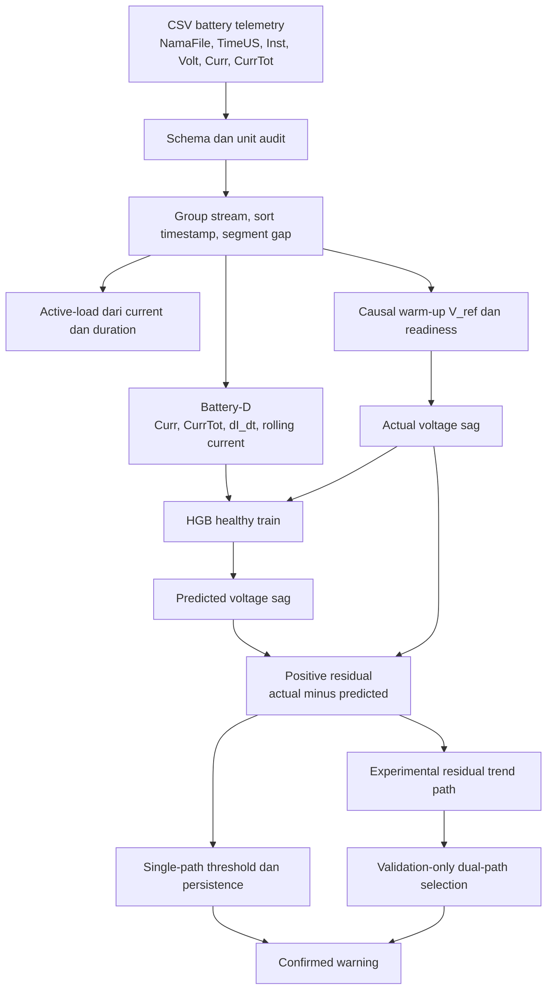
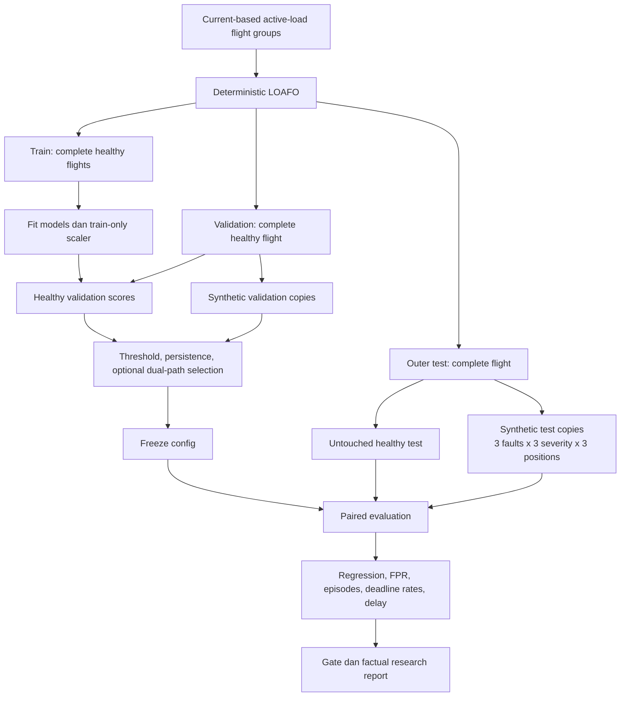

# Arsitektur V2 — Battery Only

Panah actual sag ke HGB adalah target training; actual sag bukan predictor. Saat inference, prediksi HGB hanya memakai Battery-D dan actual sag dipakai menghitung residual.

Implementasi sampai Sprint 7: `cross-validate` menjalankan baseline HGB-D; `ablation` dan `compare-models` memakai orchestrator `src/comparison.py` dengan estimator terdaftar di `src/experimental_models.py`. Setiap eksperimen menyelesaikan fit/calibration semua candidate-fold, menyimpan bundle/policy/provenance dan freeze hashes, lalu mengevaluasi outer healthy dan synthetic. Kandidat/fold dibaca kembali dari bundle untuk membatasi penggunaan memori. Seluruh hasil adalah historical development; tidak ada winner atau perubahan operational config otomatis.

HGB/RF memakai exact regression feature set A–E; IF/OCSVM memakai direct voltage behavior. OCSVM satu-satunya model dengan StandardScaler, fit full healthy-ready train sebelum deterministic train sample cap untuk SVM. Score direct signed `-decision_function` memakai threshold dalam unit model, terpisah dari residual V HGB/RF. Engine persistence dan metrik incident/denominator sama; direct models tidak diberi predicted voltage/regression metrics. Dual-path dan replay pada diagram tetap rancangan tahap lanjut.

Sprint 8 menambahkan `tune` → `src/single_path_tuning.py`: satu HGB-D per fold, empat quantile healthy validation, 20 fixed policy combinations pada healthy/synthetic validation, healthy screening dan lexicographic selection. Semua fold selesai selection dan freeze seluruh input/model/policy sebelum paired outer reference/selected. Validation base-score exports menggunakan reference decisions; seluruh grid dapat direplay dari timestamp/score. Synthetic validation tidak mengkalibrasi quantile. Outer diagnostics tidak pernah merevisi policy atau operational config. Tuning single-path kini implemented; dual-path dan replay tetap tahap lanjut.

Sprint 9 menambahkan `src/residual_diagnostics.py` untuk incremental causal signed residual delta/OLS dan `src/dual_detector.py` untuk timer A/B independen, OR union, attribution, shortlist/refinement guards dan promotion gate. `src/dual_path_experiment.py` melatih satu HGB-D per fold, memilih A dari healthy validation, mencatat 144-pair grid, shortlist maksimal tiga dan mandatory synthetic-validation refinement. Semua fold frozen sebelum paired outer. `tune-dual-path` menjalankan eksperimen; `compare-dual-path` memverifikasi/reuse run immutable yang sama. Research gate memakai paired macro means dan tidak mengaktifkan config; replay tetap tahap lanjut.

NOT_READY, reference unavailable, NOT_APPLICABLE dan PREEXISTING_ALARM harus tetap tercatat. Low-load healthy flights menghasilkan laporan false alarm tersendiri. Diagram ini adalah rancangan implementasi V2, bukan bukti seluruh modul sudah tersedia.

Sprint 10 menambahkan `evaluate-low-load` → `src/low_load.py` dan `src/low_load_reporting.py`. Entry point membutuhkan pointer eksperimen Sprint 6 yang selesai; source manifest/features/model/threshold/config diverifikasi sebelum bundle dimuat. Tidak ada implicit refit atau fallback ke kandidat Sprint 8/9. Train-ready fingerprint dipakai memverifikasi sumber marginal domain ranges. Seluruh model/threshold/ranges di-hash sebelum low-load inference.

Whole low-load flights terpisah dari active assignments. `unseen_by_model` mengikuti source train membership; `unseen_by_detector` juga mengecualikan source calibration membership. Primary first sorted frozen fold fixed sebelum prediction; setiap fold lain hanya sensitivity pada cohort yang sama. Exposure hanya dipool atas unique flights dalam satu model. Domain profiles, residual distributions, episode context dan plot mempertahankan status healthy-assumed dan batas diagnosis. Threshold/P99/persistence tetap; research-final orchestration dan replay belum diimplementasikan.

Sprint 11 menambahkan `research-evaluation` → `src/research.py`, `src/research_sources.py` dan `src/research_reporting.py`. Entry point mengaudit Sprint 0 freeze, raw/config/protocol dan versi; membekukan orchestration plan/code; mempreflight existing source catalog/pointers; membangun hanya tahap yang hilang; lalu memverifikasi lineage dan freeze records sebelum konsolidasi. Setiap modelling engine mempertahankan urutan validation selection → freeze semua candidate-fold → outer miliknya. Sequential historical development tidak dipresentasikan sebagai global untouched prospective holdout.

Resolver mengikuti parent preprocessing yang dinyatakan feature run, sehingga tidak mencampur snapshot Sprint 2 lama dengan fitur dari preprocessing yang diregenerasi pada Sprint 3. New source catalog berakar pada config/data/freeze identity, dibuat hanya dari completed sources, dan tidak mengubah sprint pointers. Low-load menerima explicit CV summary saat pipeline dibangun dari awal; pemakaian mandiri tetap mendukung pointer Sprint 6. Hasil historis valid tidak otomatis dilatih ulang karena code versi sekarang berbeda.

Consolidator menghitung ulang setiap separate synthetic series dari CSV sumber, mencocokkannya dengan JSON, lalu membuat overall/flight/family/severity/position/observability groups dan failure/NA inventory. Source-result freeze, registries model path/hash/predictors, copied small source tables, report/plots dan manifest membentuk research package. Original weights dan training/calibration provenance tetap di sumber immutable. Gate FAIL/WARNING/NOT_EVALUATED terpisah dari keberhasilan software stage. Replay dan final audit masih Tahap 12–13.

Sprint 12 menambahkan `StreamingDetector` pada `src/replay.py`: raw battery schema → exact numeric parsing/identity audit → `CausalFeatureBuilder` per stream → satu prediksi HGB Battery-D → signed residual diagnostics → `TimePersistence`. Input tidak menerima label/activity, precomputed features/sag/score, segment atau fault mask. Numerik invalid di-drop tanpa fill atau temporal state advance; duplicate/backward timestamps dan multiple instances dalam satu flight ditolak. Interleaved flights tetap terisolasi. Gap mereset rolling/dV_dt/dI_dt/slope/timer, mempertahankan locked V_ref.

`src/replay_experiment.py` memuat source set yang dipin Sprint 11, memverifikasi frozen CV/features/low-load/model/threshold dan membekukan replay plan sebelum inference. Original active flights memakai masing-masing held-out fold; low-load memakai primary frozen fold. Seluruh applicable baseline outer synthetic copies direplay dengan fresh state. Batch features/scores/diagnostics dibandingkan per row dan signal incident/deadline metrics harus sama sebelum completion manifest.

Seluruh healthy reference-ready rows menjalankan uncached single-sample model calls dengan OpenMP=1. Cache untuk salinan synthetic memakai identical model object + exact ordered predictor tuple yang sudah diproses sebelumnya; hanya prediksi yang boleh direuse. Voltage residual, reference/features, slope dan timer tetap dihitung causal. Latency UNCACHED/EXACT_INPUT_CACHE/NOT_READY dilaporkan terpisah, dengan `perf_counter_ns` untuk parsing/features/prediction/diagnostics+detector/total; file I/O, model loading dan export dikeluarkan. Replay accelerated memakai original telemetry timestamp, bukan sleep/pacing. Signal onset→confirmation sudah mencakup persistence. Status baseline software-only, bukan emergency promotion; final audit dijelaskan pada Sprint 13 berikut.

## Sprint 13 - final audit

`scripts/run_sprint13.py` memisahkan prepare, commands, audits dan finalize. Prepare memverifikasi completed manifests dan membekukan checksum program serta prior evidence. Commands menjalankan audit Sprint 0, dependency check, research/replay CLI dari direktori berbeda, cache content/mtime checks dan full pytest dari root proyek. Audit membaca saved source tables/models; keluaran verifier lama ditangkap ke direktori Sprint 13 sehingga bukti historis tidak ditimpa.

Bundle audit meliputi pilot, LOAFO, ablation/comparison, tuning dan dual-path: ordered predictors, disjoint whole-flight identities, train-only scaler/sampling, training target fingerprint dan validation-only quantile/persistence provenance. Source inventory konsolidasi terkini harus sama dengan source inventory historis. Replay boleh mempin package historisnya selama baseline/features/low-load hashes identik; recorded host timings tidak diukur ulang.

Finalize mensyaratkan tests dan audits PASS serta preservation cocok, lalu menghasilkan `FINAL_RESEARCH_RESULTS.md`, `FINAL_VERIFICATION.md`, machine-readable results, gate checks dan evidence hashes. Software PASS terpisah dari scientific target FAIL, NOT_PROMOTED dan limitation WARNING. Final audit tidak melatih ulang model proyek, memilih policy baru atau mengaktifkan deployment/hardware.
