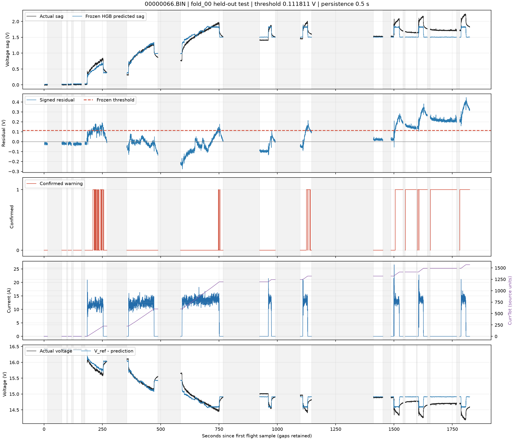
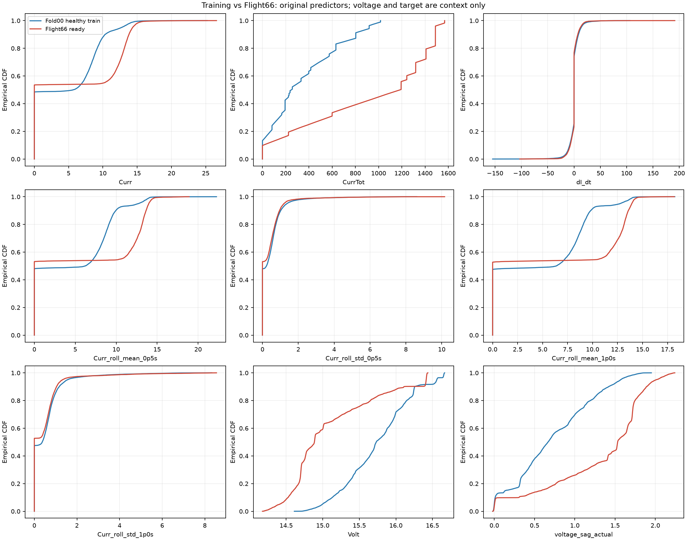
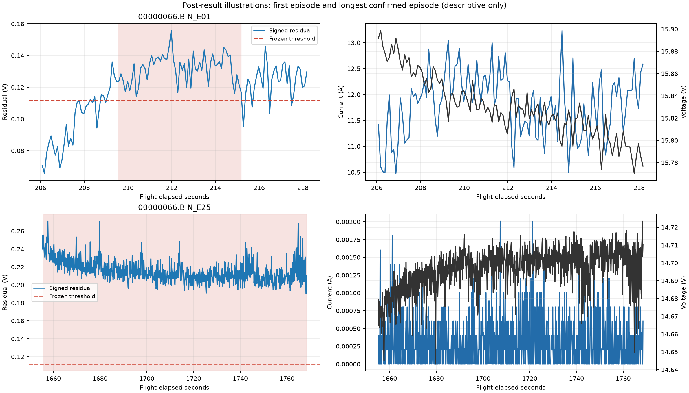
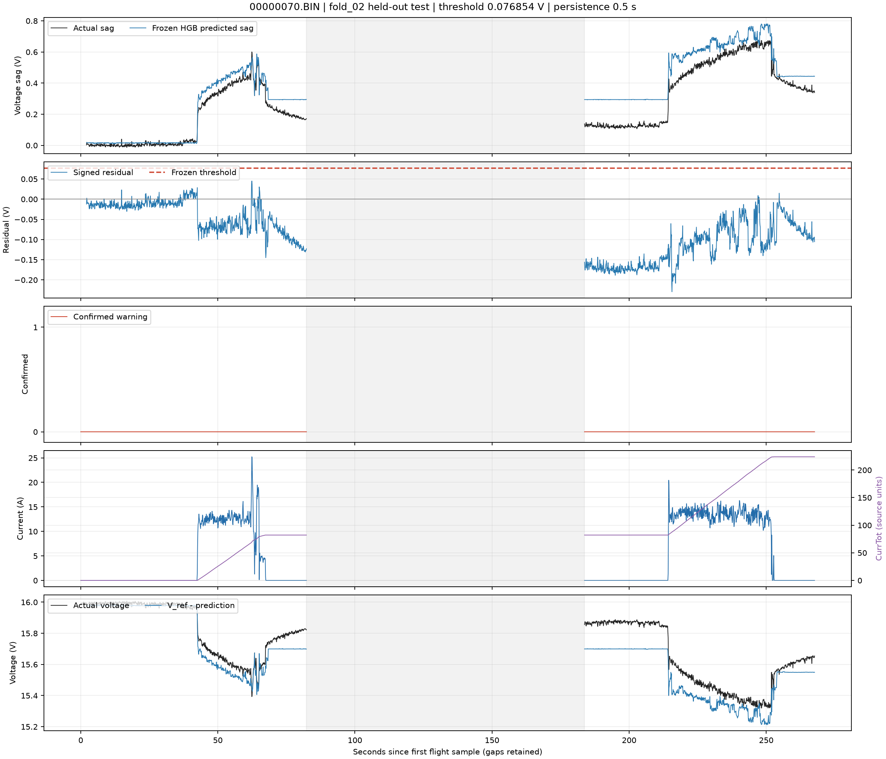

# ROOT CAUSE ANALYSIS FALSE ALARM FLIGHT 66

Tanggal: 22 Oktober 2026 (Asia/Jakarta). Status: diagnosis historis selesai, tanpa refinement.

## Kesimpulan berbasis bukti

False alarm Flight 66 terutama berasal dari **underprediction sag yang bertahan lama pada bagian akhir rekaman**, ketika `CurrTot` melampaui domain training dan level tegangan sudah lebih rendah. Model menganggap tegangan seharusnya lebih tinggi; positive residual kemudian melewati threshold selama >=0,5 s. Ini adalah mekanisme false alarm yang berhasil direproduksi, bukan bukti kerusakan internal baterai.

Reproduksi menghasilkan tepat **3.168 confirmed samples / 9.506 ready samples (33,326320%) dalam 26 episode**. Sebanyak 2.944/3.168 (92.93%) confirmed samples berada di atas maksimum `CurrTot` training; lima episode >30 s menyumbang 2.726 samples (86.05%). Episode terpanjang 112.599917 s terjadi pada arus rata-rata 0.0002999 A.

Implementasi reference/features/persistence cocok dengan protokol historis dan data tersimpan. Ada 14 telemetry gaps yang penting bagi interpretasi, tetapi tidak ditemukan salah reset, pencampuran segmen, perubahan raw, atau numeric corruption pada field CSV yang tersedia. Bukti paling kuat menunjuk keterbatasan generalisasi respons terhadap keadaan discharge/riwayat baterai. Waktu, CurrTot, dan tegangan saling terkait; diagnosis ini belum memisahkan kontribusi kausal masing-masing atau penyebab fisik penurunan tegangan.

## 1. Artefak, split, dan batas analisis

Sumber baseline immutable: `artifacts/cross_validation/4bc978e2773687d3`; feature run `1225e8a76a8ce014`. Artefak tersedia sebelum reproduksi; seluruh source manifest, raw/config freeze dan prior final-audit evidence yang direferensikan diperiksa checksum-nya. Tidak ada pemanggilan fit, tuning, reselection, penghapusan Flight 66, atau perubahan label healthy.

| Penggunaan | Model/fold | Train | Calibration | Evaluasi |
|---|---|---|---|---|
| Target Flight 66 | fold_00 | 70, 71, 73, 74 | 69 | 66 test, unseen model dan calibration |
| Control utama Flight 70 | fold_02 | 66, 69, 73, 74 | 71 | 70 test, unseen model dan calibration |
| Konteks dengan model yang sama | fold_00 yang sama persis | 70, 71, 73, 74 | 69 | 69 validation, calibration diagnostic |

Flight 66 **tidak berada dalam training ataupun calibration model fold_00 yang digunakan untuk seluruh prediksi Flight 66**. Control 70 memakai fold historisnya sendiri, yang memang sudah memuat Flight 66 dalam training. Tidak ada fitting baru. Perbandingan 66 vs 70 memakai prosedur sama, tetapi bukan perbandingan dua flight dengan model/threshold/training domain identik. Flight 69 menyediakan konteks model fold_00 yang identik, dengan keterbatasan karena calibration telah melihatnya.

Control utama dipilih sebagai active test lain dengan FPR confirmed minimum, tie-break filename terkecil, sehingga terpilih Flight 70. Ini pemilihan contoh deskriptif setelah hasil historis diketahui. Threshold Flight 66 **0.11181085884265932 V**, Flight 70 **0.076854495652616706 V**; keduanya P99 healthy-validation historis, persistence **0,5 s**. Threshold tidak diubah.

Ordered predictors tetap: `Curr`, `CurrTot`, `dI_dt`, `Curr_roll_mean_0p5s`, `Curr_roll_std_0p5s`, `Curr_roll_mean_1p0s`, `Curr_roll_std_1p0s`. Tidak ada scaler operasional. Kolom tambahan CSV hanya diagnosis. `Volt`, `V_ref`, elapsed time dan actual sag tidak dimasukkan ke prediktor HGB-D. `CurrTot` tetap unit sumber **unverified**, tanpa konversi atau klaim SOC/kapasitas.

Fingerprint exact healthy-ready training rows/targets dan validation calibration scores cocok; semua sample Flight 66 dan control diprediksi ulang dari saved object. Maximum error prediksi terhadap CSV historis <1e-12 V; raw/confirmed/episode/state/timer serta exposure historis cocok. Detail: [audit verification](audit_verification.json), [input hashes](input_manifest.json), [diagnostic plan](diagnostic_plan.json).

## 2. Actual sag, prediksi, dan residual

Definisi yang dipakai tetap:

```text
actual_sag = V_ref - Volt
signed_residual = actual_sag - HGB_prediction
score = max(0, signed_residual)
raw_alarm = reference_ready AND score > historical_threshold
confirmed = continuous raw run elapsed >= 0.5 s
```

| NamaFile | fold_id | evaluated_role | samples | raw_samples | confirmed_samples | confirmed_fpr | episodes | residual_mean_v | mae_v | rmse_v |
|---|---|---|---|---|---|---|---|---|---|---|
| 00000066.BIN | fold_00 | test | 9506 | 3447 | 3168 | 0.333263 | 26 | 0.065355 | 0.109496 | 0.144403 |
| 00000070.BIN | fold_02 | test | 1643 | 0 | 0 | 0.000000 | 0 | -0.079212 | 0.080433 | 0.098991 |
| 00000069.BIN | fold_00 | validation | 1622 | 17 | 3 | 0.001850 | 2 | -0.061415 | 0.077292 | 0.099383 |

FPR di tabel adalah fraction; denominator hanya reference-ready samples pada flight tersebut. Warm-up tetap disimpan sebagai NOT_READY tanpa prediksi. Residual positif berarti prediksi sag terlalu rendah, setara dengan prediksi tegangan terlalu tinggi.



Timestamp `TimeUS` asli dan elapsed seconds tersedia dalam CSV. Sumbu elapsed mempertahankan gaps; garis diputus di gap dan area abu-abu adalah interval tanpa telemetry, bukan sinyal hasil interpolasi. Timeline memperlihatkan beberapa alarm awal sekitar 209-256 s, bias negatif pada sebagian bagian tengah, kemudian bias positif panjang pada bagian akhir. Jadi error bukan offset konstan sepanjang flight.

Error positif terbesar pada elapsed **1809.478423 s**, TimeUS **2040371491**: Volt 14.465658 V, V_ref 16.417031 V, actual sag 1.951373 V, predicted sag 1.505668 V, residual **0.445705 V**. Curr hanya 0.000401593 A, |dI/dt| 0.004017 A/s dan rolling std 1 s 0.000370493 A. Titik ini bukan lonjakan arus besar.

## 3. CurrTot tinggi, level tegangan, dan perubahan arus

| variable | group | samples | confirmed_samples | confirmed_fpr | residual_mean_v |
|---|---|---|---|---|---|
| CurrTot | (0.0166, 401.162] | 2377 | 224 | 0.094236 | 0.025125 |
| CurrTot | (401.162, 1186.092] | 2376 | 9 | 0.003788 | -0.044113 |
| CurrTot | (1186.092, 1408.26] | 2805 | 1010 | 0.360071 | 0.062928 |
| CurrTot | (1408.26, 1568.515] | 1948 | 1925 | 0.988193 | 0.251457 |
| Volt | (14.174000000000001, 14.695] | 2377 | 1459 | 0.613799 | 0.172945 |
| Volt | (14.695, 14.885] | 2376 | 1485 | 0.625000 | 0.119261 |
| Volt | (14.885, 15.47] | 2377 | 0 | 0.000000 | -0.045473 |
| Volt | (15.47, 16.437] | 2376 | 224 | 0.094276 | 0.014687 |

Quartile dibuat deskriptif dari seluruh ready samples. Ties pada CurrTot menyebabkan jumlah samples antar-bin tidak sama. Hubungan tidak monoton sepanjang flight: quartile CurrTot kedua memiliki FPR lebih rendah daripada quartile pertama, lalu FPR melonjak di bagian akhir. Jadi 'CurrTot tinggi selalu berarti alarm' tidak didukung.

| variable | group | samples | confirmed_samples | confirmed_fpr | residual_mean_v |
|---|---|---|---|---|---|
| CurrTot_above_train_max | False | 4308 | 224 | 0.051996 | -0.014272 |
| CurrTot_above_train_max | True | 5198 | 2944 | 0.566372 | 0.131347 |
| low_current_le_1A | False | 4406 | 879 | 0.199501 | 0.040204 |
| low_current_le_1A | True | 5100 | 2289 | 0.448824 | 0.087083 |
| transient_context | False | 8928 | 3032 | 0.339606 | 0.065994 |
| transient_context | True | 578 | 136 | 0.235294 | 0.055474 |
| near_gap_after_1s | False | 9361 | 3149 | 0.336396 | 0.065960 |
| near_gap_after_1s | True | 145 | 19 | 0.131034 | 0.026281 |

Cross-strata current/CurrTot: [CSV](currtot_current_cross_strata.csv). Korelasi Spearman terhadap signed residual:

| first | correlation | samples |
|---|---|---|
| elapsed_time | 0.644740 | 9506 |
| CurrTot | 0.648776 | 9506 |
| Volt | -0.573461 | 9506 |
| Curr | -0.148023 | 9506 |
| abs_dI_dt | -0.157073 | 9506 |
| Curr_roll_std_1p0s | -0.139394 | 9506 |

Korelasi ini adalah asosiasi within-flight, dengan autocorrelation dan temporal confounding; bukan feature importance atau estimasi causal effect. Korelasi antarsemua variabel dan within-current-bin juga disimpan di [correlations.csv](correlations.csv). Tegangan sendiri merupakan bagian dari definisi actual sag/residual, sehingga korelasinya terhadap residual tidak bisa menjadi bukti kausal independen. CurrTot dan elapsed time sama-sama mengikuti perkembangan rekaman. Tidak diberikan p-value yang menganggap ribuan samples sebagai observasi independen.


## 4. Domain training dan perilaku model pada batas CurrTot

| variable | train_min | train_max | test_min | test_max | outside_train | confirmed_outside |
|---|---|---|---|---|---|---|
| Curr | 0.000000 | 25.219860 | 0.000000 | 26.569817 | 1 | 0 |
| CurrTot | 0.001319 | 1016.583374 | 0.017648 | 1568.515137 | 5198 | 2944 |
| dI_dt | -154.583743 | 106.042596 | -102.977950 | 191.396104 | 2 | 0 |
| Curr_roll_mean_0p5s | 0.000000 | 22.248801 | 0.000000 | 18.900989 | 0 | 0 |
| Curr_roll_std_0p5s | 0.000000 | 8.608626 | 0.000000 | 10.161346 | 2 | 0 |
| Curr_roll_mean_1p0s | 0.000000 | 18.225574 | 0.000000 | 18.176182 | 0 | 0 |
| Curr_roll_std_1p0s | 0.000000 | 8.330594 | 0.000000 | 8.548431 | 5 | 0 |
| Volt | 14.611464 | 16.665943 | 14.175438 | 16.436853 | 1501 | 894 |
| voltage_sag_actual | -0.020714 | 1.950542 | -0.019822 | 2.241593 | 648 | 623 |

Volt dan actual sag pada tabel adalah response context, bukan predictors. Outside-range hanya uji marginal min/max, bukan diagnosis kerusakan atau detektor OOD baru. Keluar rentang tidak otomatis menjelaskan setiap error; berada dalam rentang juga tidak membuktikan kesamaan joint distribution atau conditional response.

CurrTot training fold_00 maksimum **1016.583374**, sedangkan Flight 66 sampai **1568.515137**. Ada **5.198/9.506** ready rows melampaui maksimum itu; kelompok tersebut menyumbang **86.12%** total squared prediction error. Seluruh confirmed samples yang keluar rentang predictor adalah kasus CurrTot ini. Outlier marginal Curr/dI_dt/rolling std hanya beberapa rows dan tidak berisi confirmed samples.

Inspeksi bin mapper objek HGB tersimpan menunjukkan last CurrTot cut **1016.582214355**, dengan 255 nonmissing bins. Seluruh 5.198 rows di atas maksimum training masuk **bin 254 yang sama**. Artinya penambahan CurrTot di wilayah ini tidak lagi menyediakan perbedaan nilai fitur kepada split trees. Prediksi masih bisa berubah mengikuti enam predictor lain, tetapi model tidak mendapat resolusi tambahan pada sumbu CurrTot di wilayah tersebut.

Pada dua segmen low-current akhir, CurrTot tetap (1.408,260132 dan 1.489,035522), dan prediksi sag berada sekitar 1,496-1,514 V. Actual sag tetap lebih tinggi walaupun arus nyaris nol dan tegangan sedikit pulih selama segmen. Training low-current (<=1 A) memiliki actual sag maksimum 1,640516 V; contoh error maksimum Flight 66 mempunyai actual sag 1,951373 V. Ini bukti conditional response mismatch pada keadaan akhir rekaman, bukan semata outlier current.

Sebanyak 224 confirmed samples masih berada di dalam rentang CurrTot training, terutama segmen 4. Karena itu ekstrapolasi CurrTot tidak menjelaskan seluruh 26 episode. Distribusi load dan hubungan load-to-sag juga berbeda antarpenerbangan. [Training context](fold00_training_context.csv) menyimpan statistik train per flight/current-state; residual training adalah **in-sample**, bukan unseen FPR.

Nearest actual training row pada tujuh predictor juga disimpan per sample (flight/source_record/distance/target difference). Jarak memakai median/IQR training, fallback std untuk IQR kecil, **hanya untuk diagnosis**, tanpa mengubah input model. Tidak dipasang cutoff OOD atau ditafsirkan sebagai confidence probability. Identitas tetangga tidak berarti baterai/timestamp/kondisi fisiknya sepadan.



## 5. Reference voltage dan kualitas data

V_ref Flight 66 = **16.417031288147 V**, median **20** samples dengan Curr <=1 A dalam warm-up 2 s pertama. Ada **20** warm-up rows; lock pada elapsed **2.000194 s**. Reference tidak dihitung dari masa depan dan nilainya tetap pada seluruh 15 segmen, sesuai strategi fixed warm-up yang juga dipakai training dan control.

V_ref awal Flight 66 berada di dalam rentang V_ref training (15,709306-16,648390 V), sehingga initial reference outlier bukan penjelasan kuat. Fixed reference membuat penurunan level tegangan kumulatif tetap tercermin dalam actual sag setelah gap, termasuk saat current kembali kecil. Ini konsekuensi target historis yang harus dipelajari regressor, bukan kesalahan menghitung median atau salah menerapkan reset.

Data CSV Flight 66 memiliki 9.526 rows, satu instance (Inst=0), tanpa nonfinite numeric, duplicate/backward timestamp, negative Volt/Curr/CurrTot, atau CurrTot decrease. Nilai raw yang dipakai features cocok exact dengan source CSV. Ini mendukung tidak adanya numeric/ordering corruption pada ekspor tersedia; audit ini tidak dapat memverifikasi sensor calibration, metadata pack, firmware, atau kebenaran kesehatan baterai dari .BIN asli yang tidak disertakan.

Penurunan tegangan yang diamati belum boleh disebut sensor drift, kenaikan internal resistance, battery failure atau SOC ground truth. Healthy tetap **assumed_from_source**, sesuai permintaan dan kontrak dataset.

## 6. Gap, segment boundaries, rolling dan persistence

Flight 66: **15 segments / 14 gaps >0,5 s**, total gap **873.578781 s**. Elapsed span 1.824,678372 s, ready observed duration **949.099397 s**. Interval dengan gap/warm-up tidak masuk denominator exposure. Tidak dilakukan fill/interpolasi.

Oracle independen menghitung ulang derivative actual dt, rolling `(t-window,t]` 0,5/1 s dengan ddof=0, count/coverage/readiness dan segment ID. Maximum feature difference sekitar 1,78e-15. Pada batas segmen derivative menjadi nol, rolling mulai satu sample, persistence run dimulai ulang. Locked V_ref dipertahankan sesuai protokol. Seluruh raw/confirmed/state/duration dan episode starts cocok dengan keluaran historis.

Hanya **19/3.168** confirmed samples (0,60%) berada dalam satu detik pertama sesudah segment start, sehingga artefak rolling/persistence sesaat pada batas segmen bukan penyumbang utama. Empat episode berakhir saat gap dan timer benar-benar reset; setelah telemetry muncul lagi, alarm memerlukan >=0,5 s raw run baru. Tidak ada konfirmasi yang menumpuk durasi lintas gap. Gaps tetap membatasi pengetahuan tentang aktivitas/voltage recovery yang tidak terekam.

Seluruh detail per-segment, gap_before, ready/confirmed counts, reference dan first-row timer/rolling count: [segments.csv](segments.csv).

## 7. Semua confirmed false-alarm episodes Flight 66

Durasi adalah last-confirmed minus first-confirmed timestamp. Ini observed span, tidak diekstrapolasi sampai sampel berikutnya atau melintasi gap. Satu confirmed sample memiliki span 0 s tetapi tetap didahului raw run >=0,5 s; raw start dan persistence elapsed disimpan terpisah. Total observed confirmed spans 314,199260 s, bukan 3.168 samples dikali interval nominal. Nilai current/voltage/residual di tabel dirata-ratakan pada confirmed samples.

| episode_id | segment_id | confirmed_start_s | confirmed_span_seconds | confirmed_samples | Curr_mean | CurrTot_start | Volt_mean | residual_mean_v | end_reason |
|---|---|---|---|---|---|---|---|---|---|
| 00000066.BIN_E01 | 4 | 209.578517 | 5.600047 | 57 | 11.895285 | 79.024612 | 15.825454 | 0.131743 | raw_false |
| 00000066.BIN_E02 | 4 | 216.278511 | 0.099984 | 2 | 11.810056 | 101.056114 | 15.786036 | 0.140153 | raw_false |
| 00000066.BIN_E03 | 4 | 217.078512 | 0.299983 | 4 | 11.786842 | 103.648125 | 15.795828 | 0.131517 | raw_false |
| 00000066.BIN_E04 | 4 | 218.178517 | 1.599956 | 17 | 12.704303 | 107.328812 | 15.768311 | 0.146648 | raw_false |
| 00000066.BIN_E05 | 4 | 221.078513 | 2.700015 | 28 | 12.276604 | 117.433090 | 15.753820 | 0.140099 | raw_false |
| 00000066.BIN_E06 | 4 | 224.678517 | 0.200014 | 3 | 10.763772 | 129.727997 | 15.765948 | 0.127254 | raw_false |
| 00000066.BIN_E07 | 4 | 229.178475 | 0.100038 | 2 | 11.481654 | 143.723526 | 15.736241 | 0.120698 | raw_false |
| 00000066.BIN_E08 | 4 | 231.378534 | 0.000000 | 1 | 11.857042 | 150.727921 | 15.711093 | 0.135478 | raw_false |
| 00000066.BIN_E09 | 4 | 233.578495 | 0.699984 | 8 | 11.628458 | 157.957245 | 15.706732 | 0.134665 | raw_false |
| 00000066.BIN_E10 | 4 | 240.178560 | 4.500000 | 46 | 12.668257 | 178.903412 | 15.646908 | 0.143887 | raw_false |
| 00000066.BIN_E11 | 4 | 246.278492 | 0.300019 | 4 | 10.853611 | 199.679703 | 15.661294 | 0.130978 | raw_false |
| 00000066.BIN_E12 | 4 | 247.278514 | 0.400015 | 5 | 11.090080 | 202.603012 | 15.649283 | 0.130515 | raw_false |
| 00000066.BIN_E13 | 4 | 248.478538 | 4.399919 | 45 | 12.487261 | 206.643127 | 15.610300 | 0.157593 | raw_false |
| 00000066.BIN_E14 | 4 | 255.678513 | 0.099917 | 2 | 0.000636 | 224.027069 | 15.918513 | 0.118533 | raw_false |
| 00000066.BIN_E15 | 6 | 747.378510 | 0.300012 | 4 | 14.085132 | 1180.113403 | 14.472725 | 0.125861 | raw_false |
| 00000066.BIN_E16 | 6 | 748.478514 | 0.399906 | 5 | 13.761719 | 1184.401978 | 14.469321 | 0.128116 | raw_false |
| 00000066.BIN_E17 | 6 | 752.978418 | 1.199971 | 13 | 0.000345 | 1193.741943 | 14.786916 | 0.123467 | raw_false |
| 00000066.BIN_E18 | 8 | 1124.778528 | 5.099886 | 52 | 12.779378 | 1300.987061 | 14.457522 | 0.142559 | raw_false |
| 00000066.BIN_E19 | 8 | 1130.978447 | 8.299940 | 84 | 0.000373 | 1319.350586 | 14.758772 | 0.149253 | raw_false |
| 00000066.BIN_E20 | 8 | 1140.678423 | 0.699998 | 8 | 0.000301 | 1319.350586 | 14.795232 | 0.117618 | raw_false |
| 00000066.BIN_E21 | 10 | 1505.278498 | 33.399922 | 335 | 6.872928 | 1344.717651 | 14.531688 | 0.211887 | gap_segment_reset |
| 00000066.BIN_E22 | 11 | 1548.678398 | 47.700002 | 478 | 0.000335 | 1408.260132 | 14.762456 | 0.148326 | gap_segment_reset |
| 00000066.BIN_E23 | 12 | 1600.678390 | 5.100016 | 52 | 3.095788 | 1408.260132 | 14.701890 | 0.150372 | raw_false |
| 00000066.BIN_E24 | 12 | 1607.078526 | 35.699916 | 358 | 7.265043 | 1417.151855 | 14.457440 | 0.284791 | gap_segment_reset |
| 00000066.BIN_E25 | 13 | 1655.878408 | 112.599917 | 1127 | 0.000300 | 1489.035522 | 14.696853 | 0.215039 | gap_segment_reset |
| 00000066.BIN_E26 | 14 | 1781.978489 | 42.699883 | 428 | 6.684834 | 1489.035522 | 14.430491 | 0.325082 | flight_end |

CSV lengkap memuat absolute TimeUS, raw-start/confirmed-start/end, current/voltage min-mean-max, CurrTot start/end, actual/predicted sag, residual, transient context, low-current counts dan ending reason: [false_alarm_episodes.csv](false_alarm_episodes.csv). Hanya Flight 66 ada pada tabel di atas; CSV juga memuat dua calibration episodes Flight 69 yang dilabel dengan flight ID, sementara control 70 tidak mempunyai episode.



## 8. Bias lama versus load transient

Deskripsi transient ditetapkan dari fold_00 training: |dI/dt| > **18.283741 A/s** ATAU rolling std current 1 s > **1.557163 A** (masing-masing P95). Ini label konteks untuk analisis, tidak mempengaruhi detector. Sebanyak **3.032/3.168 (95.71%)** confirmed samples berada di luar konteks transient tersebut; **2.289/3.168 (72.25%)** pada Curr <=1 A.

Untuk menghindari klaim hanya dari instant derivative, dihitung elapsed consecutive low-current run per segment. Setelah current <=1 A bertahan >=10 s tanpa konteks transient, masih ada **1.604 confirmed samples** dari 2.965 samples kondisi itu. Sensitivitas definisi 5/10/30 s tersedia pada condition_strata.csv; ini pemeriksaan deskriptif, bukan pemilihan persistence baru.

Pada fixed 10-s blocks per segmen yang mempunyai observed span >=5 s, **35/92** blocks mempunyai median residual di atas threshold; **20** di antaranya tanpa sample berkonteks transient. Lima episode >30 s menyumbang 2.726 confirmed samples. Episode E25 selama 112,599917 s pada current hampir nol merupakan bukti langsung persistent bias.

Load changes tetap berkaitan dengan sebagian error awal dan sesaat. Sebanyak 224 confirmed samples pada segmen 4 muncul saat CurrTot masih dalam rentang training, mayoritas saat arus sekitar 11-13 A. Tidak semua error sementara tersebut melewati batas P95 transient; kedekatan residual dengan threshold juga membuat run terpecah menjadi beberapa episode. Karena itu tidak tepat menyamakan semua short episodes dengan load-transient error atau menyatakan semua alarm disebabkan satu fitur.

## 9. Perbandingan dengan active flight ber-FPR rendah

Flight 70 memakai prosedur yang sama: raw-to-reference audit, original seven predictors, own historical model, validation-only P99, persistence 0,5 s, independent timer/rolling checks, domain comparison terhadap own training set, dan episode extraction. Hasilnya 0 raw/confirmed alarm dari 1.643 ready samples / 164,100118 ready seconds. V_ref 15,993141 V; dua segmen/satu gap. CurrTot maksimum hanya 223,967438 dan minimum voltage 15,317132 V, jauh dari bagian akhir Flight 66.

Mean signed residual Flight 70 **-0,079212 V**: model cenderung memprediksi sag lebih besar, sehingga score positif jarang muncul. Nol FPR tidak berarti regressor bebas bias atau sensitivitas fault sudah ideal. Control mempunyai durasi/domain dan fitted model berbeda; hasil ini mendukung adanya perbedaan generalisasi respons, tetapi tidak mengisolasi satu penyebab.

Flight 69 diuji ulang dengan model fold_00 yang sama persis dengan Flight 66, tanpa Flight 66 dalam train/calibration model tersebut. Hasilnya 17 raw samples, tiga confirmed samples, dua episode dari 1.622 ready samples (0,184957% confirmed FPR). Mean residual -0,061415 V; CurrTot maksimum 403,116760. Ini menunjukkan threshold yang sama tidak menghasilkan FPR besar pada domain calibration tersebut. Karena Flight 69 menentukan threshold, hasilnya hanya calibration diagnostic, bukan independent test evidence.



[Calibration Flight 69 timeline](plots/00000069_timeline.png) dan [grafik perbandingan ketiga flight](plots/flight66_vs_control.png).

## 10. Temuan terbukti, hipotesis, dan penilaian akhir

| Status bukti | Kesimpulan |
|---|---|
| Terbukti dari reproduksi | FPR tinggi berasal dari residual sag positif yang bertahan melewati threshold/persistence historis, dengan prediksi dan decisions identik sumber. |
| Terbukti dari objek model | Semua CurrTot di atas maksimum training digabung ke uppermost bin yang sama; sumbu CurrTot tidak membedakan perkembangan lebih lanjut di sana. |
| Terbukti dari stratifikasi | 92,93% confirmed samples dan 86,12% total squared prediction error berada pada domain CurrTot di atas maksimum training; bias panjang berarus rendah dominan. |
| Terbukti dari audit | Fixed V_ref, features, segment/gap dan timer sesuai protokol; tidak ditemukan numeric/ordering corruption CSV atau carry-over persistence lintas gap. |
| Didukung kuat, belum causal decomposition | Keterbatasan representasi/generalisasi pada respons akhir discharge dan reference-relative voltage level merupakan penjelasan ML utama. |
| Belum terbukti | CurrTot sebagai penyebab tunggal; pengaruh terpisah dari waktu/voltage/SOC, perbedaan pack/capacity/temperature/aging, calibration sensor, session continuity dan penyebab fisik perubahan voltage. |

**Penilaian kualitas data versus generalisasi:** kualitas numeric/ordering ekspor yang tersedia tidak menjelaskan alarm. Gaps cukup besar dan metadata kesehatan/pack belum tersedia, sehingga kualitas observasi fisik belum sepenuhnya terjamin. Dengan batas tersebut, hasil diagnosis lebih kuat menunjukkan masalah generalisasi/conditional bias model pada bagian akhir Flight 66 dibanding bug preprocessing atau reset. Healthy tidak diubah dan kerusakan baterai tidak disimpulkan.

**Faktor terbesar:** kondisi CurrTot tinggi bersama level tegangan rendah dan underprediction yang berlangsung lama. Batas bin CurrTot memberi mekanisme representasi yang konkret. Load transient adalah faktor sekunder dan tidak menjelaskan episode terpanjang/error maksimum. 'Voltage drift' di sini hanya perubahan level tegangan teramati terhadap initial reference; tidak identik dengan sensor drift. Korelasi tidak cukup untuk memberi persentase kontribusi kausal CurrTot versus voltage history.

## 11. Rekomendasi refinement berikutnya, menurut kekuatan bukti

1. **Perluas data development healthy pada akhir discharge dan low-current setelah load**, lintas pack/flight/session dengan metadata kondisi yang terukur. Bukti: support CurrTot training berhenti sebelum >setengah ready Flight 66, dan long low-current bias dominan. Tentukan development/validation baru dan holdout flight/pack yang belum diperiksa sebelum mencoba konfigurasi baru.
2. **Tinjau representasi keadaan baterai dan target fixed-reference sebagai studi terpisah**, termasuk state/history yang bisa tersedia secara causal dan perbedaan initial condition. Bukti: sag low-current tinggi tetap muncul saat short-window current hampir sama; fixed V_ref mengekspresikan perubahan level kumulatif yang tidak sepenuhnya dijelaskan predictor sekarang. Ini rekomendasi penelitian, bukan mengganti reference/fit pada diagnosis ini.
3. **Verifikasi unit/reset/continuity CurrTot dan metadata pack/session**, lalu rancang penanganan domain di luar support sebagai eksperimen yang diprotocol-kan. Bukti: upper-bin saturation langsung teramati. Jangan langsung menafsirkan CurrTot sebagai SOC atau menganggap clipping/normalization pasti menghilangkan bias.
4. **Evaluasi calibration transfer dan uncertainty/OOD monitoring lintas kondisi** setelah representasi/data memadai. Bukti: residual fold00 validation berpusat negatif sementara late Flight 66 positif panjang. Menaikkan threshold atau memperpanjang persistence dengan Flight 66 dapat menyembunyikan gejala dan merusak sensitivity; manfaatnya harus diuji pada development baru dan fault/healthy denominators tetap.
5. **Teliti mismatch respons saat load dan recovery sebagai prioritas berikutnya**, terutama 224 alarms di rentang CurrTot training. Bukti untuk kebutuhan ini ada, tetapi transient correction saja tidak menjangkau sebagian besar confirmed samples yang stabil dan panjang.

Semua rekomendasi belum diimplementasikan. Seluruh Flight 66 kini jelas merupakan data diagnosis/development yang telah diperiksa; memakai hasilnya untuk memilih konfigurasi berikutnya lalu menyebut Flight 66 independent holdout tidak sah. Tidak ada ground truth kerusakan internal pada data ini.

## Artefak dan reproduksi

- [Prediksi/residual semua 9.526 samples Flight 66](00000066_predictions_residuals.csv), termasuk 20 warm-up rows dengan prediction null.
- [Control Flight 70 per sample](00000070_predictions_residuals.csv); [Flight 69 calibration per sample](00000069_predictions_residuals.csv).
- [Seluruh episodes](false_alarm_episodes.csv), [segment/gap audit](segments.csv), [feature distributions](feature_distribution.csv), [training context](fold00_training_context.csv).
- [Condition strata](condition_strata.csv), [current/CurrTot cross-strata](currtot_current_cross_strata.csv), [10-s bias blocks](bias_windows_10s.csv), [correlations](correlations.csv).
- [Summary CSV](flight_summary.csv), [machine-readable results](results.json), [verification](audit_verification.json), [input hashes](input_manifest.json), [evidence hashes](evidence_manifest.json).

```powershell
.\.venv\Scripts\python.exe scripts/diagnose_flight66.py
```

Script memuat saved models dan melakukan predict tanpa fit. Seluruh **345 prior files** pada preservation scope dicocokkan sebelum/sesudah. Pengulangan hanya meregenerasi artefak diagnosis pada folder ini. Grafik diagnostik diperiksa visual untuk label, gap breaks, domain dan episode context.

Exposure group pada condition_strata hanya statistik deskriptif dengan sample FPR; episode starts dalam strata berarti lokasi onset episode, bukan episode-rate subgroup yang didefinisikan ulang. Main episode rates/denominator historis tetap pada summary sumber. Tidak ada inferensi independensi antar-sample atau klaim causal feature importance.

CSV per sample mempertahankan NamaFile/Inst/TimeUS/source_record, segment dan readiness asli, seluruh tujuh predictors, V_ref/Volt/CurrTot, actual/predicted sag, reproduced_prediction_v, predicted_voltage_v, signed residual, score/threshold, anomaly_raw/duration/confirmed/state dan episode ID. `VoltageSag_actual`/`VoltageSag_predicted` adalah alias yang diminta untuk kolom canonical proyek; nilainya identik. Diagnostic nearest-training/bins/range flags/transient/low-current-run bukan input atau keputusan tambahan. Semua timing telemetry dalam mikrodetik atau detik sesuai suffix; tegangan/residual dalam V, Curr dalam A, dI_dt dalam A/s, dan CurrTot source units unverified.
