# Deteksi anomali respons tegangan baterai UAV — laporan penelitian HGB V2

Disusun 26 Oktober 2026 (Asia/Jakarta). Baseline LOAFO `4bc978e2773687d3`; konsolidasi `4ad7e153513e7d64`; diagnosis Flight 66 historis. Struktur dan tampilan mengikuti template yang diberikan; data, rumus, fitur, dan hasil berasal dari artefak HGB V2 aktif. Laporan ini membaca hasil tersimpan dan melakukan re-agregasi, tanpa menjalankan ulang training atau memilih konfigurasi.

## 1. Hasil utama dan cakupan klaim

Baseline mendeteksi **156/162 applicable synthetic events (96,296296%)**, tetapi **3.178/26.870 healthy-assumed ready samples (11,827317%)** juga menghasilkan confirmed alarm. Kinerja regresi pooled yang tinggi, R²=0,946481, belum menjamin false alarm rendah atau respons cepat terhadap gangguan gradual. Target abrupt severe ≤1 s tercapai 36/36; target progressive observable ≤5 s hanya 12/51 (23,529412%), sehingga belum tercapai.

| Metrik utama | Hasil | Denominator / interpretasi |
| --- | --- | --- |
| MAE / RMSE (V) | 0,101865 / 0,138278 | 26.870 unique healthy test ready samples |
| R² pooled | 0,946481 | Target sag; bukan akurasi deteksi |
| Healthy confirmed FPR (%) | 11,827317 | 3.178 / 26.870 |
| Episode / menit | 0,648431 | 29 episodes / 2.683,400543 observed ready seconds |
| Event recall (%) | 96,296296 | 156 / 162; 6 missed; 0 preexisting |
| Synthetic sample precision / recall / F1 | 0,437978 / 0,806741 / 0,567735 | Seluruh ready rows dalam 162 salinan |
| Delay median / mean (s) | 0,699965 / 5,526932 | n=156 detected-only; persistence sudah termasuk |

Enam flight active dan sebelas log low-load telah ditelaah selama pengembangan. Evaluasi ini adalah historical development cross-validation; keenam test flight terpisah dari training dan calibration dalam fold masing-masing, tetapi bukan independent final holdout baru untuk klaim sesudah pemilihan metode. Label healthy berasal dari asumsi sumber, bukan hasil pemeriksaan kesehatan baterai independen. Alarm pada healthy-assumed disebut false positive relatif terhadap label tersebut. Salinan sintetis tidak menambah jumlah penerbangan independen.

## 2. Data, ekstraksi, preprocessing, dan fitur kausal

Pipeline V2 dimulai dari `data/raw/dataset_baterai.csv`, bukan decoder log BIN. Nama `00000066.BIN` dan seterusnya adalah identitas sumber yang tercatat di CSV. Repo aktif tidak menyediakan converter BIN ke CSV maupun log BIN asli untuk baseline ini. Script persiapan dataset mengemas CSV yang tersedia; laporan ini tidak mengklaim telah mengekstrak ulang data dari log asli. Schema sumber: NamaFile, TimeUS, Inst, Volt, Curr, CurrTot. TimeUS dinyatakan µs, Volt dalam V, Curr dalam A; unit CurrTot tetap unverified dan tidak dikonversi menjadi SOC atau kapasitas.

Audit tersimpan mempertahankan seluruh 32.338 baris / 17 flights, tanpa dropped rows pada dataset ini. Terdapat 92 continuous segments dan 75 gaps. Observed exposure 3.224,801403 s; excluded gap duration 2.138,817494 s. Sampling nominal 10 Hz hanya menjadi konteks; segmentasi dan timer menggunakan timestamp aktual, dengan gap strictly >0,5 s memulai segmen baru.

| Flight | Kategori arus | Retained | Ready | Warm-up | Ready exposure (s) | V_ref (V) |
| --- | --- | --- | --- | --- | --- | --- |
| 00000061 | LOW_LOAD_OR_IDLE | 421 | 400 | 21 | 39,800083 | 16,554817 |
| 00000062 | LOW_LOAD_OR_IDLE | 486 | 465 | 21 | 45,698940 | 16,547434 |
| 00000063 | LOW_LOAD_OR_IDLE | 353 | 332 | 21 | 32,699879 | 16,493322 |
| 00000064 | LOW_LOAD_OR_IDLE | 1.088 | 1.067 | 21 | 105,799401 | 16,531696 |
| 00000065 | LOW_LOAD_OR_IDLE | 146 | 126 | 20 | 12,499943 | 16,418150 |
| 00000066 | ACTIVE_LOAD | 9.526 | 9.506 | 20 | 949,099397 | 16,417031 |
| 00000067 | LOW_LOAD_OR_IDLE | 144 | 123 | 21 | 12,199987 | 16,542046 |
| 00000068 | LOW_LOAD_OR_IDLE | 588 | 568 | 20 | 56,400415 | 16,533665 |
| 00000069 | ACTIVE_LOAD | 1.642 | 1.622 | 20 | 161,999919 | 16,507204 |
| 00000070 | ACTIVE_LOAD | 1.664 | 1.643 | 21 | 164,100118 | 15,993141 |
| 00000071 | ACTIVE_LOAD | 1.006 | 986 | 20 | 98,299889 | 15,709306 |
| 00000072 | LOW_LOAD_OR_IDLE | 369 | 348 | 21 | 34,400329 | 16,496592 |
| 00000073 | ACTIVE_LOAD | 8.738 | 8.718 | 20 | 870,801230 | 16,562006 |
| 00000074 | ACTIVE_LOAD | 4.415 | 4.395 | 20 | 439,099990 | 16,648390 |
| 00000075 | LOW_LOAD_OR_IDLE | 328 | 307 | 21 | 30,599996 | 15,725013 |
| 00000076 | LOW_LOAD_OR_IDLE | 739 | 718 | 21 | 70,500645 | 15,731488 |
| 00000077 | LOW_LOAD_OR_IDLE | 685 | 665 | 20 | 65,999836 | 15,714390 |

ACTIVE_LOAD ditetapkan ulang dari Curr ≥1 A pada continuous run minimal 1 s dan active exposure minimal 5% dari observed duration. Klasifikasi ini menghasilkan flight 66, 69, 70, 71, 73, 74. Sebelas lainnya LOW_LOAD_OR_IDLE. Kategori arus tidak menentukan airborne/ground; bagian low-current dalam active flight tetap disertakan. Sensitivitas aturan arus 0,5/1/2 A dan durasi 0,5/1/2 s pada audit historis menghasilkan daftar enam active flight yang sama.

Reference menggunakan median sampel Curr≤1 A dalam fixed warm-up awal sampai elapsed≤2 s, minimum lima sampel. Nilai dikunci pada sampel pertama strictly setelah akhir window. Reference yang terkunci dipertahankan melintasi gap. Tanpa sampel cukup, reference tetap unavailable; pada dataset ini semua 17 flight berhasil mengunci reference. Total 349 warm-up rows tidak ikut fitting maupun denominator alarm. V_ref merupakan reference empiris awal log, bukan estimasi OCV/SOC.

| Urutan | Prediktor Battery-D | Definisi dan batas |
| --- | --- | --- |
| 1 | Curr | Arus saat ini (A) |
| 2 | CurrTot | Kanal akumulasi sumber; unit/reset fisik belum diverifikasi |
| 3 | dI_dt | ΔCurr/Δt native dalam segmen (A/s); awal segmen diisi 0 |
| 4 | Curr_roll_mean_0p5s | Mean aritmetika pada (t−0,5 s,t] |
| 5 | Curr_roll_std_0p5s | Std populasi ddof=0 pada window sama |
| 6 | Curr_roll_mean_1p0s | Mean aritmetika pada (t−1 s,t] |
| 7 | Curr_roll_std_1p0s | Std populasi ddof=0 pada window sama |

Rolling memakai sampel masa lalu dan sampel saat ini; satu sampel menghasilkan std=0. Gap menghapus history rolling/derivative dan mereset persistence, sedangkan fixed V_ref tetap terkunci. Reference-ready adalah dasar scoring baseline; flags count/coverage/derivative readiness adalah diagnostik dan bukan persyaratan full-window baru. Karena itu warm-up ulang satu detik pada setiap segmen dari template tidak diterapkan pada V2. Volt aktual, V_ref, target sag, residual, dV_dt, ID, label dan readiness tidak masuk X HGB-D; elapsed_time hanya ada pada ablation Battery-E. Tidak ada scaler operasional HGB.

## 3. Split, estimator, threshold, dan rumus injeksi aktif

| Fold | Training flights | Validation | Test |
| --- | --- | --- | --- |
| fold_00 | 00000070 / 00000071 / 00000073 / 00000074 | 00000069 | 00000066 |
| fold_01 | 00000066 / 00000071 / 00000073 / 00000074 | 00000070 | 00000069 |
| fold_02 | 00000066 / 00000069 / 00000073 / 00000074 | 00000071 | 00000070 |
| fold_03 | 00000066 / 00000069 / 00000070 / 00000074 | 00000073 | 00000071 |
| fold_04 | 00000066 / 00000069 / 00000070 / 00000071 | 00000074 | 00000073 |
| fold_05 | 00000069 / 00000070 / 00000071 / 00000073 | 00000066 | 00000074 |

Setiap fold menggunakan empat flight healthy-assumed untuk fitting, satu flight validation utuh untuk threshold, dan satu flight test utuh. Semua reference-ready rows dari assigned training flights, termasuk low-current, ikut fitting. Enam model dan kebijakan sudah dibekukan sebelum outer scoring. HGB mempelajari target kontinu secara supervised pada data nominal; tahapan deteksi tidak memerlukan contoh fault untuk fitting baseline.

| Parameter HGB | Nilai frozen |
| --- | --- |
| loss | squared_error |
| learning_rate | 0,050000 |
| max_iter | 200 |
| max_leaf_nodes | 31 |
| max_depth | None |
| min_samples_leaf | 20 |
| l2_regularization | 0,100000 |
| max_bins | 255 |
| early_stopping | Tidak |
| random_state | 42 |

| Fold | Validation | Ready samples | P99 threshold (V) |
| --- | --- | --- | --- |
| fold_00 | 00000069 | 1.622 | 0,111811 |
| fold_01 | 00000070 | 1.643 | 0,024280 |
| fold_02 | 00000071 | 986 | 0,076854 |
| fold_03 | 00000073 | 8.718 | 0,114844 |
| fold_04 | 00000074 | 4.395 | 0,289378 |
| fold_05 | 00000066 | 9.506 | 0,381905 |

```text
y(t) = V_ref − Volt(t)
r(t) = y(t) − y_predicted(t)
score(t) = max(0, r(t))
raw(t) = reference_ready(t) AND score(t) > P99_validation
confirmed(t) = raw true secara kontinu dengan elapsed timestamp ≥0,5 s
```

Threshold menggunakan percentile 99 dengan interpolasi linear dari score positive residual validation fold terkait. Run raw dimulai pada timestamp exceedance pertama; false/unready atau boundary segmen memutus run. Persistensi 0,5 s merupakan elapsed time, bukan lima sampel. Onset sintetis tidak mereset timer. Bias residual negatif tetap dihitung pada error regresi, tetapi dipetakan ke score=0 oleh detector satu arah.

| Family | Added sag a(t) | Grid dan dukungan |
| --- | --- | --- |
| increased_resistance | a(t)=Curr(t)·ΔR | ΔR=0,02 / 0,05 / 0,08 Ω; longest valid active run |
| progressive | a(t)=Curr(t)·ΔR_max·clip((t−t0)/D,0,1) | ΔR_max=0,02 / 0,05 / 0,08 Ω; D=end−onset pada active run |
| sudden_drop | a(t)=ΔV·min(1,(t−t0)/0,4 s) | ΔV=0,5 / 1,0 / 1,5 V; longest continuous ready segment |

Pada support: Volt_injected=Volt_original−a(t), sag_injected=V_ref−Volt_injected. Arus, fitur arus, CurrTot, V_ref dan readiness tetap berasal dari sumber. Karena X tidak berubah, prediksi HGB-D untuk setiap salinan sama dengan prediksi nominal. dV_dt dihitung ulang untuk kebutuhan direct baselines, termasuk saat kembali ke telemetry asli. Intervensi memodelkan perubahan respons listrik yang terkontrol; tambahan ΔR bukan pengukuran resistansi internal dan bukan simulasi elektrokimia lengkap.

Untuk setiap family dipilih segmen eligible terpanjang; tie-break timestamp awal. Requested onset berada pada fraksi 0,4/0,5/0,6 durasi segmen, lalu aligned ke sampel pertama at/after timestamp itu. Seluruh tail dari onset sampai sampel terakhir segmen terpilih adalah support inklusif [t0,t_end], minimum post-onset 1 s. Tidak ada durasi event tetap 1/2/4 s pada baseline ini. Sampel onset progressive/sudden ramp bisa memiliki efek nol dan tetap berlabel support. Setelah support, telemetry asli kembali tanpa recovery ramp buatan. Grid menghasilkan 3 families ×3 severities ×3 onsets ×6 active flights=162 events, satu event per salinan.

Bedakan dari bank generator seluruh 17 flights: 459 planned, 261 applicable, 198 NOT_APPLICABLE. Outer active baseline hanya mengevaluasi 162 applicable events tersebut. Angka 261 atau 459 bukan denominator recall baseline. NA tidak diinferensikan sebagai kegagalan deteksi maupun keberhasilan.

## 4. Healthy test: regresi, bias, dan false alarm per flight

| Flight | Ready | MAE V | RMSE V | R² | Mean residual V | FP | FPR % | Episodes/min |
| --- | --- | --- | --- | --- | --- | --- | --- | --- |
| 00000066 | 9.506 | 0,109496 | 0,144403 | 0,942748 | 0,065355 | 3.168 | 33,326320 | 1,643663 |
| 00000069 | 1.622 | 0,096776 | 0,114124 | 0,751723 | -0,090252 | 8 | 0,493218 | 0,740741 |
| 00000070 | 1.643 | 0,080433 | 0,098991 | 0,784303 | -0,079212 | 0 | 0,000000 | 0,000000 |
| 00000071 | 986 | 0,023362 | 0,031524 | 0,980505 | 0,005691 | 0 | 0,000000 | 0,000000 |
| 00000073 | 8.718 | 0,112600 | 0,149698 | 0,913224 | 0,020203 | 2 | 0,022941 | 0,068902 |
| 00000074 | 4.395 | 0,091566 | 0,136582 | 0,869007 | -0,036893 | 0 | 0,000000 | 0,000000 |

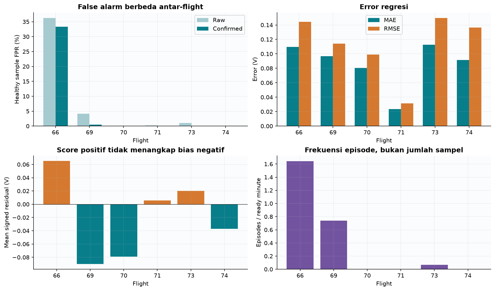

[Versi SVG](figures/healthy_overview.svg).

Healthy denominator menghitung setiap ready test row sekali: 26.870 samples, 2.683,400543 s. Raw FPR=3.607/26.870 (13,423893%); confirmed FPR=3.178/26.870 (11,827317%). Episode rate=29/(2.683,400543/60)=0,648431/min. Interval exposure hanya dijumlah bila dua ujung ready dan berada pada segmen yang sama; warm-up serta gap tidak menjadi waktu observasi detector. FPR berbasis sampel dan laju episode berbasis waktu mengukur aspek yang berbeda.

Flight 66 menyumbang 3.168/3.178 (99,685337%) confirmed healthy-assumed samples. Lima flight lain bersama-sama menghasilkan sepuluh confirmed samples; statistik ini menunjukkan konsentrasi error dan tidak menjadi alasan menghapus Flight 66. Flight 70 mempunyai mean signed residual −0,079212 V dan nol alarm detector positif: model masih bias meski FPR nol. Pooled R² tinggi juga dipengaruhi variasi target antarflight; per-fold R² dan error tetap disajikan agar variasi domain terlihat.

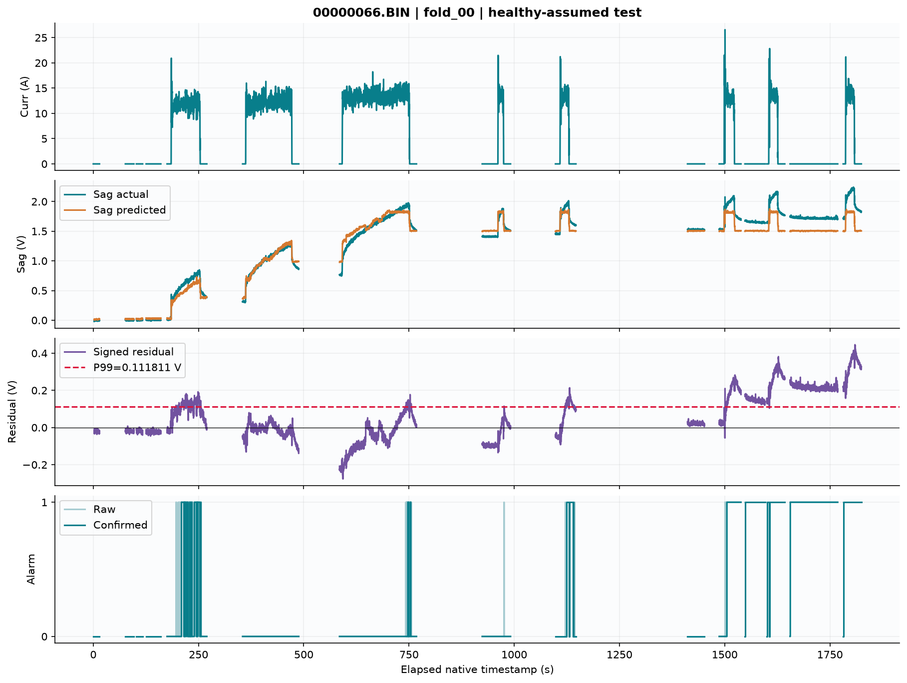

[Versi SVG](figures/healthy_00000066.svg).

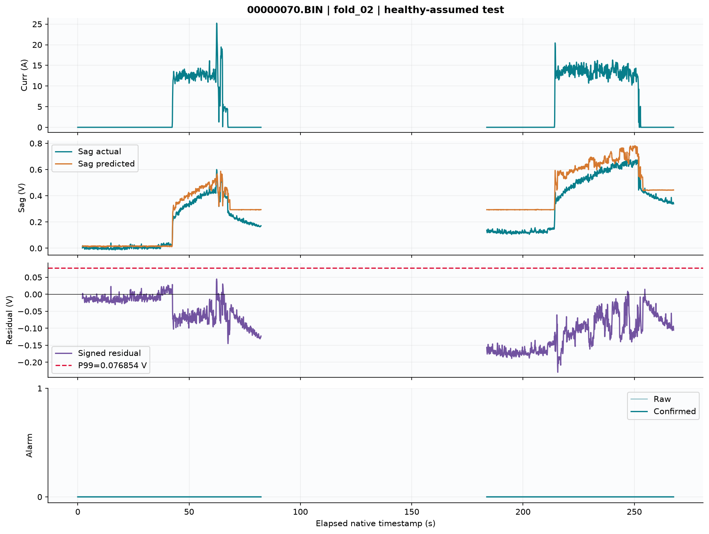

[Versi SVG](figures/healthy_00000070.svg).

## 5. Evaluasi event, sampel, delay, dan deadline

| Seri | Applicable | Detected | Missed | Preexisting | Event recall % | Delay n |
| --- | --- | --- | --- | --- | --- | --- |
| confirmed | 162 | 156 | 6 | 0 | 96,296296 | 156 |
| raw | 162 | 162 | 0 | 0 | 100,000000 | 162 |

Confirmed event sukses memerlukan episode konfirmasi baru di dalam support. Bila alarm confirmed sudah dibawa ke onset tanpa episode start baru di sampel onset, seluruh event PREEXISTING_ALARM dan tidak diberi fresh credit. Miss/preexisting tetap denominator; delay null. Pada run ini preexisting=0 untuk kedua seri. Seri raw tambahan dalam laporan diperoleh secara deskriptif dari mask raw tersimpan dengan aturan episode dan support yang sama; tidak dipromosikan sebagai konfigurasi detector baru.

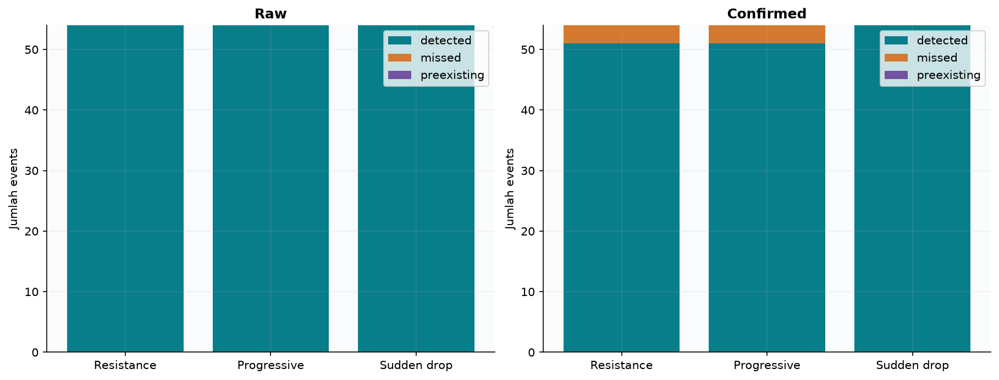

[Versi SVG](figures/event_outcomes.svg).

| Fold / test | Detected/applicable | Missed | Sample F1 | Delay n | Median s | Mean s |
| --- | --- | --- | --- | --- | --- | --- |
| fold_00 / 00000066 | 27/27 | 0 | 0,314312 | 27 | 0,699954 | 8,977767 |
| fold_01 / 00000069 | 27/27 | 0 | 0,932606 | 27 | 0,600331 | 2,666744 |
| fold_02 / 00000070 | 27/27 | 0 | 0,935934 | 27 | 0,699888 | 2,522265 |
| fold_03 / 00000071 | 27/27 | 0 | 0,950257 | 27 | 0,600039 | 1,988861 |
| fold_04 / 00000073 | 27/27 | 0 | 0,868625 | 27 | 0,799989 | 8,748145 |
| fold_05 / 00000074 | 21/27 | 6 | 0,779904 | 21 | 0,800144 | 9,038064 |

| Family | Detected/applicable | Missed | Recall % | Delay median s | Delay mean s |
| --- | --- | --- | --- | --- | --- |
| increased_resistance | 51/54 | 3 | 94,444444 | 0,500079 | 1,043123 |
| progressive | 51/54 | 3 | 94,444444 | 11,999830 | 15,125521 |
| sudden_drop | 54/54 | 0 | 100,000000 | 0,699954 | 0,696308 |

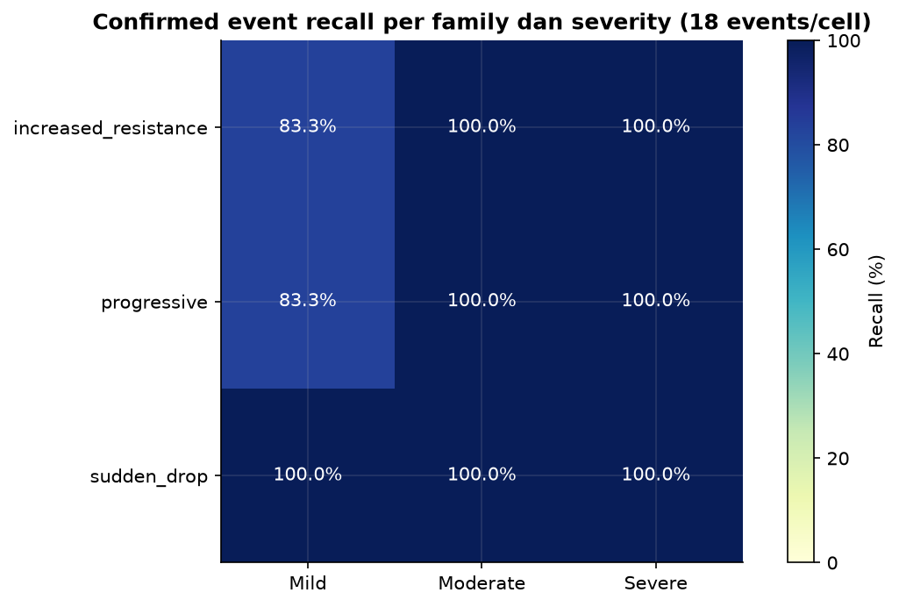

[Versi SVG](figures/scenario_grid.svg).

Ringkasan berdasarkan severity; seluruh kelompok, tanpa memilih tingkat yang paling berhasil.

| severity | Detected/applicable | Recall % | Delay n | Median s | Mean s |
| --- | --- | --- | --- | --- | --- |
| mild | 48/54 | 88,888889 | 48 | 0,799992 | 7,483348 |
| moderate | 54/54 | 100,000000 | 54 | 0,699959 | 5,612965 |
| severe | 54/54 | 100,000000 | 54 | 0,699943 | 3,701864 |

Ringkasan berdasarkan start_position; seluruh kelompok, tanpa memilih tingkat yang paling berhasil.

| start_position | Detected/applicable | Recall % | Delay n | Median s | Mean s |
| --- | --- | --- | --- | --- | --- |
| 0,400000 | 52/54 | 96,296296 | 52 | 0,700015 | 6,240419 |
| 0,500000 | 52/54 | 96,296296 | 52 | 0,700013 | 5,601934 |
| 0,600000 | 52/54 | 96,296296 | 52 | 0,699954 | 4,738444 |

Ringkasan berdasarkan observability; seluruh kelompok, tanpa memilih tingkat yang paling berhasil.

| observability | Detected/applicable | Recall % | Delay n | Median s | Mean s |
| --- | --- | --- | --- | --- | --- |
| HIGH | 126/126 | 100,000000 | 126 | 0,699949 | 3,646834 |
| LOW | 3/3 | 100,000000 | 3 | 32,799982 | 32,899949 |
| MEDIUM | 27/33 | 81,818182 | 27 | 7,499790 | 11,259277 |

| Seri | TP | FP | TN | FN | Precision % | Sample recall % | F1 % |
| --- | --- | --- | --- | --- | --- | --- | --- |
| confirmed | 66.440 | 85.257 | 557.877 | 15.916 | 43,797834 | 80,674146 | 56,773466 |
| raw | 69.654 | 95.454 | 547.680 | 12.702 | 42,186932 | 84,576716 | 56,294249 |

Confusion counts dihitung pada seluruh ready rows tiap salinan, termasuk prefix dan telemetry setelah support: confirmed total 725.490 rows, positive support 82.356, negative background 643.134. Sample recall=TP/(TP+FN), precision=TP/(TP+FP), F1=2TP/(2TP+FP+FN). Background yang berulang membuat precision/F1 bergantung desain bank dan durasi support. Synthetic sample FPR=85.257/643.134 (13,256491%) mempunyai scope berbeda dari original healthy FPR. Event recall 96,30% tidak berarti 96,30% sampel gangguan terdeteksi.

| Deadline s | Raw success/162 | Confirmed success/162 | Confirmed % |
| --- | --- | --- | --- |
| 1 | 105/162 | 101/162 | 62,345679 |
| 2 | 112/162 | 102/162 | 62,962963 |
| 5 | 125/162 | 115/162 | 70,987654 |
| 10 | 139/162 | 129/162 | 79,629630 |
| 30 | 156/162 | 149/162 | 91,975309 |

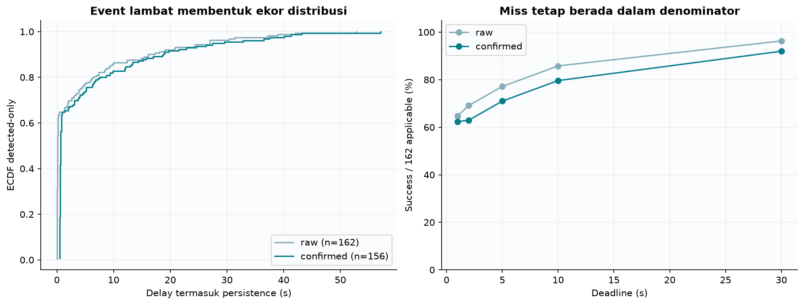

[Versi SVG](figures/delays_deadlines.svg).

Mean delay confirmed 5,526932 s jauh di atas median 0,699965 s karena sebagian progressive events baru terkonfirmasi lama setelah onset. Persistence sudah terkandung dalam timestamp first confirmation dan tidak ditambahkan ulang. Tidak ada confidence interval iid antar-sampel: pengamatan dalam flight dan salinan fault saling bergantung; unit domain utama tetap hanya enam flight historis.

| Flight | Family | Severity | Onset fraction | Max added sag V | Threshold V | Reason |
| --- | --- | --- | --- | --- | --- | --- |
| 00000074 | increased_resistance | mild | 0,400000 | 0,309966 | 0,381905 | NO_NEW_CONFIRMATION_WITHIN_SUPPORT |
| 00000074 | increased_resistance | mild | 0,500000 | 0,309966 | 0,381905 | NO_NEW_CONFIRMATION_WITHIN_SUPPORT |
| 00000074 | increased_resistance | mild | 0,600000 | 0,309966 | 0,381905 | NO_NEW_CONFIRMATION_WITHIN_SUPPORT |
| 00000074 | progressive | mild | 0,400000 | 0,256502 | 0,381905 | NO_NEW_CONFIRMATION_WITHIN_SUPPORT |
| 00000074 | progressive | mild | 0,500000 | 0,255294 | 0,381905 | NO_NEW_CONFIRMATION_WITHIN_SUPPORT |
| 00000074 | progressive | mild | 0,600000 | 0,253480 | 0,381905 | NO_NEW_CONFIRMATION_WITHIN_SUPPORT |

Keenam misses berasal dari Flight 74 pada mild increased_resistance dan mild progressive, masing-masing tiga onset. Semua tetap dalam denominator. Tidak ada threshold, dosis atau label yang diubah untuk menutup kegagalan tersebut.

| Target penelitian | Success / denominator | Hasil % | Target % | Status |
| --- | --- | --- | --- | --- |
| Abrupt severe ≤1 s | 36 / 36 | 100,000000 | 80,000000 | MET |
| Progressive observable ≤5 s | 12 / 51 | 23,529412 | 70,000000 | NOT_MET |

Grup abrupt severe dalam protokol mencakup increased_resistance severe dan sudden_drop severe; progressive observable hanya memakai subset progressive kategori MEDIUM/HIGH (max added sag ≥0,20 V). Batas observability: VERY_LOW <0,05 V; LOW ≥0,05 dan <0,20 V; MEDIUM ≥0,20 dan <0,50 V; HIGH ≥0,50 V. Definisi grup mengikuti sumber historis. Eventual recall progressive observable 48/51 tidak menggantikan target deadline 12/51. Kegagalan mencapai deadline merupakan hasil penelitian meskipun software berjalan benar.

## 6. Pooled dan macro: pengaruh denominator

Pooled MAE=Σabsolute_error/Σn, pooled RMSE=√(ΣSSE/Σn). Pooled R²=1−ΣSSE/(Σy²−(Σy)²/Σn), sehingga tidak dihitung sebagai rata-rata R² fold. Macro adalah mean aritmetika nilai per fold yang terdefinisi; n_defined disertakan dan undefined tidak diganti nol. Jumlah event sama per fold membuat pooled/macro incident recall sama, tetapi hal ini tidak berlaku bagi healthy FPR, F1, regresi atau mean delay detected-only.

| Scope | Metrik | Macro mean | Population std | Median | Min | Max | n_defined |
| --- | --- | --- | --- | --- | --- | --- | --- |
| regression | mae_v | 0,085705 | 0,029891 | 0,094171 | 0,023362 | 0,112600 | 6 |
| regression | rmse_v | 0,112554 | 0,040257 | 0,125353 | 0,031524 | 0,149698 | 6 |
| regression | r2 | 0,873585 | 0,082289 | 0,891115 | 0,751723 | 0,980505 | 6 |
| healthy_active | raw_fpr | 0,069398 | 0,131916 | 0,006233 | 0,000000 | 0,362613 | 6 |
| healthy_active | confirmed_fpr | 0,056404 | 0,123828 | 0,000115 | 0,000000 | 0,333263 | 6 |
| healthy_active | confirmed_episodes_per_minute | 0,408884 | 0,612638 | 0,034451 | 0,000000 | 1,643663 | 6 |
| synthetic | precision | 0,863917 | 0,300979 | 0,998456 | 0,190919 | 1,000000 | 6 |
| synthetic | recall | 0,826520 | 0,094490 | 0,877838 | 0,639216 | 0,905229 | 6 |
| synthetic | f1 | 0,796940 | 0,223454 | 0,900616 | 0,314312 | 0,950257 | 6 |
| synthetic | synthetic_sample_fpr | 0,060829 | 0,135551 | 0,000123 | 0,000000 | 0,363930 | 6 |
| synthetic | incident_recall | 0,962963 | 0,082817 | 1,000000 | 0,777778 | 1,000000 | 6 |
| synthetic | pre_fault_fpr | 0,009495 | 0,020842 | 0,000000 | 0,000000 | 0,056093 | 6 |
| synthetic | delay_mean_seconds | 5,656974 | 3,272046 | 5,707445 | 1,988861 | 9,038064 | 6 |
| synthetic | delay_median_seconds | 0,700057 | 0,081601 | 0,699921 | 0,600039 | 0,800144 | 6 |
| synthetic | deadline_le_1s_rate | 0,623457 | 0,069014 | 0,666667 | 0,481481 | 0,666667 | 6 |
| synthetic | deadline_le_2s_rate | 0,629630 | 0,056575 | 0,666667 | 0,518519 | 0,666667 | 6 |
| synthetic | deadline_le_5s_rate | 0,709877 | 0,111965 | 0,722222 | 0,555556 | 0,851852 | 6 |
| synthetic | deadline_le_10s_rate | 0,796296 | 0,173390 | 0,814815 | 0,555556 | 1,000000 | 6 |
| synthetic | deadline_le_30s_rate | 0,919753 | 0,117932 | 0,962963 | 0,666667 | 1,000000 | 6 |

Contoh: healthy confirmed FPR pooled 11,827317%, macro 5,640413%, median fold 0,011471%. Flight 66 memiliki banyak sampel dan FPR besar, sehingga bobotnya tinggi pada pooled. Synthetic F1 pooled 0,567735 versus macro 0,796940; keduanya sah untuk estimand berbeda. Perbedaan ini harus dijelaskan dan tidak digunakan untuk memilih angka yang tampak paling baik.

## 7. Besar efek dan mekanisme error residual

| Family | Severity | Events | Median max added sag V | Max added sag V | Median max effect / T | Median support s |
| --- | --- | --- | --- | --- | --- | --- |
| increased_resistance | mild | 18 | 0,317953 | 0,799183 | 2,819233 | 38,499961 |
| increased_resistance | moderate | 18 | 0,794884 | 1,997957 | 7,048082 | 38,499961 |
| increased_resistance | severe | 18 | 1,271814 | 3,196731 | 11,276931 | 38,499961 |
| progressive | mild | 18 | 0,262228 | 0,420188 | 2,553575 | 38,499961 |
| progressive | moderate | 18 | 0,655571 | 1,050471 | 6,383938 | 38,499961 |
| progressive | severe | 18 | 1,048913 | 1,680754 | 10,214301 | 38,499961 |
| sudden_drop | mild | 18 | 0,500000 | 0,500000 | 4,412779 | 60,800047 |
| sudden_drop | moderate | 18 | 1,000000 | 1,000000 | 8,825559 | 60,800047 |
| sudden_drop | severe | 18 | 1,500000 | 1,500000 | 13,238338 | 60,800047 |

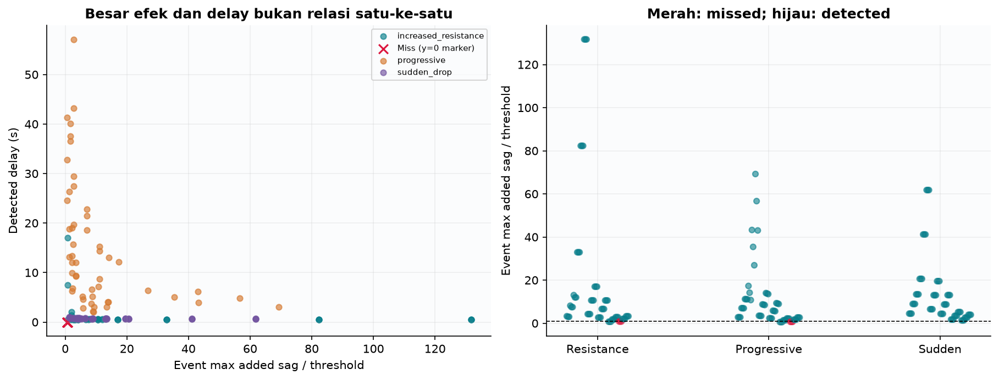

[Versi SVG](figures/effects_threshold.svg).

Dengan X dan V_ref tetap, residual_injected=residual_original+added_sag. Karena itu keberhasilan tergantung bukan hanya amplitudo fault tetapi juga bias nominal lokal. Model yang memprediksi sag terlalu besar menghasilkan residual negatif; tambahan sag terlebih dahulu mengurangi bias negatif sebelum score menjadi positif dan melampaui threshold. Jika nominal residual sudah positif mendekati threshold, gangguan kecil dapat lebih cepat menghasilkan exceedance. Ratio max effect/T adalah statistik deskriptif; nilai >1 bukan jaminan fresh confirmation dengan persistence.

Progressive meningkatkan ΔR secara bertahap sepanjang sisa segmen, sehingga crossing ditentukan arus, kecepatan ramp, posisi onset, nominal error dan threshold fold. Mean delay yang besar konsisten dengan mekanisme gradual tersebut; korelasi deskriptif tidak mengidentifikasi kontribusi kausal masing-masing. Sudden drop memberi perubahan tegangan absolut yang tidak bergantung arus, sedangkan resistance hanya besar ketika arus tinggi. Perbedaan support dan dosis membuat recall antarfamily bukan perbandingan gangguan fisik yang setara.

## 8. Root cause analysis Flight 66 dan pembanding

Diagnosis memakai saved model fold_00 asli: training 70/71/73/74, calibration 69, test 66. Flight 66 tidak dipakai untuk training atau calibration model yang menilainya. Prediksi dan timer direproduksi identik pada audit historis. Control Flight 70 memakai fold_02 miliknya sendiri; model itu mencakup Flight 66 sebagai training. Flight 69 dengan model fold_00 adalah konteks calibration, bukan test independen. Perbedaan role ini tetap dipertahankan.

| Bukti terukur | Interpretasi yang didukung |
| --- | --- |
| 3.168 confirmed samples, 26 episodes; 33,326320% FPR | Long positive residual runs melampaui P99=0,111810859 V |
| 2.944/3.168 (92,929293%) alarms di atas CurrTot maksimum training | Mayoritas alarm berasosiasi domain counter di luar support training |
| CurrTot train max 1.016,583374; Flight 66 max 1.568,515137 | Upper histogram bin model menyatukan seluruh nilai tinggi; tidak mengekstrapolasi tren counter di sana |
| 5 episodes >30 s memuat 2.726 confirmed samples | Bias panjang mendominasi jumlah alarm, bukan hanya burst sesaat |
| Episode terpanjang 112,599917 s; arus mean sekitar 0,000300 A | Load transient tidak menjelaskan episode dominan ini |
| 2.289 alarms pada Curr≤1 A; 1.604 setelah low-current≥10 s tanpa transient context | Mismatch tetap bertahan setelah perubahan beban mereda |
| V_ref=16,417031288 V, tetap pada 15 segmen | Perubahan level voltage relatif terhadap reference awal masuk target sag |
| Audit 14 gaps; max rolling error 1,78e−15; timer exact | Tidak ditemukan bug segment/reset/rolling pada data tersedia |

Batas domain CurrTot memberi mekanisme representasi model yang konkret. Namun CurrTot, waktu dan level tegangan berubah bersama; bukti ini belum memisahkan kontribusi kausalnya. Istilah voltage drift pada laporan berarti perubahan level tegangan teramati terhadap initial reference, bukan bukti sensor drift. Sebanyak 224 alarms tetap terjadi saat CurrTot dalam rentang training, sehingga counter tinggi tidak menjelaskan setiap episode. Data CSV tidak menunjukkan numeric/ordering corruption yang menjelaskan alarm; penyebab fisik baterai, pack, temperatur, kalibrasi atau kontinuitas sesi belum terbukti.

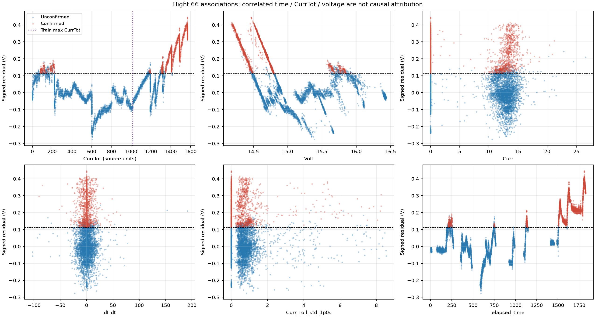


| Episode | Segmen | Start elapsed s | Confirmed span s | Samples | Mean Curr A | CurrTot start | Mean Volt V | Mean residual V | Akhir |
| --- | --- | --- | --- | --- | --- | --- | --- | --- | --- |
| E01 | 4 | 209,578517 | 5,600047 | 57 | 11,895285 | 79,024612 | 15,825454 | 0,131743 | raw_false |
| E02 | 4 | 216,278511 | 0,099984 | 2 | 11,810056 | 101,056114 | 15,786036 | 0,140153 | raw_false |
| E03 | 4 | 217,078512 | 0,299983 | 4 | 11,786842 | 103,648125 | 15,795828 | 0,131517 | raw_false |
| E04 | 4 | 218,178517 | 1,599956 | 17 | 12,704303 | 107,328812 | 15,768311 | 0,146648 | raw_false |
| E05 | 4 | 221,078513 | 2,700015 | 28 | 12,276604 | 117,433090 | 15,753820 | 0,140099 | raw_false |
| E06 | 4 | 224,678517 | 0,200014 | 3 | 10,763772 | 129,727997 | 15,765948 | 0,127254 | raw_false |
| E07 | 4 | 229,178475 | 0,100038 | 2 | 11,481654 | 143,723526 | 15,736241 | 0,120698 | raw_false |
| E08 | 4 | 231,378534 | 0,000000 | 1 | 11,857042 | 150,727921 | 15,711093 | 0,135478 | raw_false |
| E09 | 4 | 233,578495 | 0,699984 | 8 | 11,628458 | 157,957245 | 15,706732 | 0,134665 | raw_false |
| E10 | 4 | 240,178560 | 4,500000 | 46 | 12,668257 | 178,903412 | 15,646908 | 0,143887 | raw_false |
| E11 | 4 | 246,278492 | 0,300019 | 4 | 10,853611 | 199,679703 | 15,661294 | 0,130978 | raw_false |
| E12 | 4 | 247,278514 | 0,400015 | 5 | 11,090080 | 202,603012 | 15,649283 | 0,130515 | raw_false |
| E13 | 4 | 248,478538 | 4,399919 | 45 | 12,487261 | 206,643127 | 15,610300 | 0,157593 | raw_false |
| E14 | 4 | 255,678513 | 0,099917 | 2 | 0,000636 | 224,027069 | 15,918513 | 0,118533 | raw_false |
| E15 | 6 | 747,378510 | 0,300012 | 4 | 14,085132 | 1.180,113403 | 14,472725 | 0,125861 | raw_false |
| E16 | 6 | 748,478514 | 0,399906 | 5 | 13,761719 | 1.184,401978 | 14,469321 | 0,128116 | raw_false |
| E17 | 6 | 752,978418 | 1,199971 | 13 | 0,000345 | 1.193,741943 | 14,786916 | 0,123467 | raw_false |
| E18 | 8 | 1.124,778528 | 5,099886 | 52 | 12,779378 | 1.300,987061 | 14,457522 | 0,142559 | raw_false |
| E19 | 8 | 1.130,978447 | 8,299940 | 84 | 0,000373 | 1.319,350586 | 14,758772 | 0,149253 | raw_false |
| E20 | 8 | 1.140,678423 | 0,699998 | 8 | 0,000301 | 1.319,350586 | 14,795232 | 0,117618 | raw_false |
| E21 | 10 | 1.505,278498 | 33,399922 | 335 | 6,872928 | 1.344,717651 | 14,531688 | 0,211887 | gap_segment_reset |
| E22 | 11 | 1.548,678398 | 47,700002 | 478 | 0,000335 | 1.408,260132 | 14,762456 | 0,148326 | gap_segment_reset |
| E23 | 12 | 1.600,678390 | 5,100016 | 52 | 3,095788 | 1.408,260132 | 14,701890 | 0,150372 | raw_false |
| E24 | 12 | 1.607,078526 | 35,699916 | 358 | 7,265043 | 1.417,151855 | 14,457440 | 0,284791 | gap_segment_reset |
| E25 | 13 | 1.655,878408 | 112,599917 | 1.127 | 0,000300 | 1.489,035522 | 14,696853 | 0,215039 | gap_segment_reset |
| E26 | 14 | 1.781,978489 | 42,699883 | 428 | 6,684834 | 1.489,035522 | 14,430491 | 0,325082 | flight_end |

Confirmed span=timestamp terakhir confirmed−timestamp pertama confirmed dalam episode, tidak menambah interval nominal. Satu sampel confirmed mempunyai span nol walaupun raw sebelumnya sudah berlangsung ≥0,5 s. Gap memutus episode. Total spans dan sample counts adalah ukuran berbeda; CSV lengkap menyertakan raw start, voltage/current min-mean-max dan kondisi domain. Status healthy-assumed tidak diubah sebagai akibat alarm.

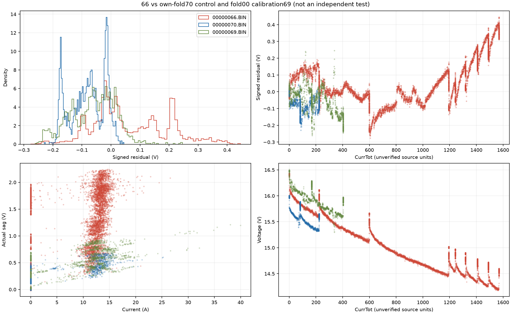

## 9. Ablation, pembanding model, tuning, dan low-load

Eksperimen berikut dilaporkan sebagai konteks development yang sudah selesai. Kebijakan baseline tetap frozen dan tidak dipilih ulang berdasarkan tabel outer. Ablation membandingkan representasi fitur; family dan estimator memiliki domain score berbeda sehingga threshold masing-masing dikalibrasi pada validation yang ditetapkan.

| Feature set | Prediktor |
| --- | --- |
| Battery-A | Curr |
| Battery-B | Curr + CurrTot |
| Battery-C | Battery-B + dI_dt |
| Battery-D | Battery-C + current rolling mean/std 0,5 dan 1,0 s |
| Battery-E | Battery-D + elapsed_time; ablation saja |

| Candidate | Healthy FPR % | Episodes/min | Detected/applicable | Sample F1 | RMSE V |
| --- | --- | --- | --- | --- | --- |
| hgb_battery_d | 11,827317 | 0,648431 | 156/162 | 0,567735 | 0,138278 |
| rf_battery_d | 11,254187 | 0,894388 | 156/162 | 0,577312 | 0,150129 |
| if_direct | 0,000000 | 0,000000 | 22/162 | 0,002038 | — |
| ocsvm_direct | 0,059546 | 0,089439 | 80/162 | 0,266648 | — |

| Ablation | Healthy FPR % | Episodes/min | Detected/applicable | F1 | RMSE V |
| --- | --- | --- | --- | --- | --- |
| hgb_battery_a | 26,702642 | 1,788775 | 51/162 | 0,246763 | 0,790650 |
| hgb_battery_b | 12,132490 | 0,782589 | 156/162 | 0,556668 | 0,138216 |
| hgb_battery_c | 11,600298 | 0,715510 | 156/162 | 0,564540 | 0,137071 |
| hgb_battery_d | 11,827317 | 0,648431 | 156/162 | 0,567735 | 0,138278 |
| hgb_battery_e | 21,622627 | 0,603712 | 117/162 | 0,439440 | 0,208748 |
| rf_battery_a | 23,289914 | 2,168890 | 51/162 | 0,246725 | 0,807488 |
| rf_battery_b | 10,930406 | 0,581352 | 156/162 | 0,574067 | 0,152153 |
| rf_battery_c | 11,213249 | 0,603712 | 156/162 | 0,569863 | 0,153606 |
| rf_battery_d | 11,254187 | 0,894388 | 156/162 | 0,577312 | 0,150129 |
| rf_battery_e | 23,074060 | 0,737870 | 108/162 | 0,397812 | 0,315753 |

RF Battery-D sedikit lebih tinggi F1 pooled tetapi episodes/min lebih tinggi dan RMSE lebih besar daripada HGB-D; tabel ini tidak menetapkan pemenang baru. IF nol healthy FPR hanya mendeteksi 22/162 events. OCSVM mendeteksi 80/162. FPR rendah saja tidak membuktikan detector sensitif. Direct IF/OCSVM melihat voltage_sag_actual, Curr, CurrTot, dV_dt dan dI_dt; OCSVM memakai scaler healthy-training-only dan capped deterministic training. Battery-E memasukkan elapsed_time dan tetap ablation.

| Eksperimen | Policy | FPR % | Episodes/min | Events | F1 | Mean delay s |
| --- | --- | --- | --- | --- | --- | --- |
| tuning | reference | 11,827317 | 0,648431 | 156/162 | 0,567735 | 5,526932 |
| tuning | selected | 11,883141 | 0,737870 | 156/162 | 0,568402 | 5,232046 |
| dual_path | reference | 11,827317 | 0,648431 | 156/162 | 0,567735 | 5,526932 |
| dual_path | selected | 9,151470 | 0,536633 | 162/162 | 0,613357 | 7,264810 |

Tuning single-path menguji 120 kombinasi percentile/persistence pada validation, kemudian membekukannya sebelum outer. Dual-path menambah slope path dengan pemilihan validation dan refinement terbatas. Dual selected memperoleh eventual recall 162/162 dan F1 lebih tinggi, tetapi mean delay bertambah dan beberapa deadline memburuk. Gate predeclared menggunakan paired arithmetic macro pada fold sama; hasil pooled tidak menggantikannya. Keputusan tetap NOT_PROMOTED dan dual_path.enabled=false.

| Gate promosi dual | Reference macro | Selected macro | Lulus |
| --- | --- | --- | --- |
| healthy_fpr | 0,056404 | 0,044224 | Ya |
| episodes_per_minute | 0,408884 | 0,407395 | Ya |
| f1 | 0,796940 | 0,802624 | Ya |
| deadline_1s | 0,623457 | 0,611111 | Tidak |
| deadline_2s | 0,629630 | 0,623457 | Tidak |
| deadline_5s | 0,709877 | 0,722222 | Ya |
| deadline_10s | 0,796296 | 0,783951 | Tidak |
| deadline_30s | 0,919753 | 0,907407 | Tidak |
| mean_incident_delay | 5,656974 | 7,264810 | Tidak |

| Frozen model | Low-load ready samples | Confirmed samples | Episodes | FPR % | Exposure s |
| --- | --- | --- | --- | --- | --- |
| fold_00 | 5.119 | 0 | 0 | 0,000000 | 506,599454 |
| fold_01 | 5.119 | 150 | 3 | 2,930260 | 506,599454 |
| fold_02 | 5.119 | 4 | 1 | 0,078140 | 506,599454 |
| fold_03 | 5.119 | 0 | 0 | 0,000000 | 506,599454 |
| fold_04 | 5.119 | 0 | 0 | 0,000000 | 506,599454 |
| fold_05 | 5.119 | 0 | 0 | 0,000000 | 506,599454 |

Sebelas unique low-load flights memberi 5.119 ready samples dan 506,599454 s. Primary fold_00 menghasilkan nol alarm; sensitivitas enam frozen models menghasilkan 150 confirmed samples pada fold_01 dan empat pada fold_02. Menggunakan ulang 11 flight pada enam model memberi 66 model–flight pairs, bukan 66 flight independen. Studi ini hanya mengukur false alarm pada domain low-load dan tidak menguji fault sensitivity low-load.

## 10. Timeline deterministik dan akses seluruh artefak

Aturan pemilihan grafik ditentukan dari metadata: severity mild, start_position=0,5, seluruh enam flight dan tiga family. Hasilnya 18 contoh tanpa memilih berdasarkan sukses/gagal. Plot memuat actual/predicted sag, raw score, threshold dan confirmed; warna support menunjukkan interval fault. Garis diputus pada segment boundary, tidak menginterpolasi gaps. Contoh Flight 74 memperlihatkan miss yang tetap terlihat.

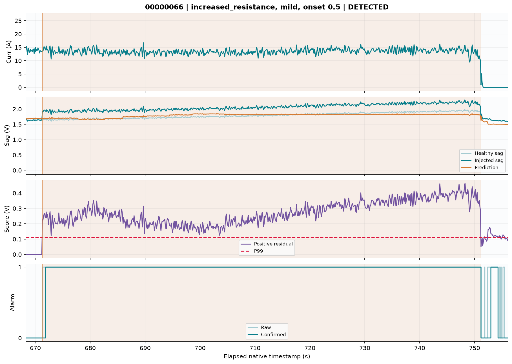

[Versi SVG](figures/timeline_00000066_increased_resistance.svg).

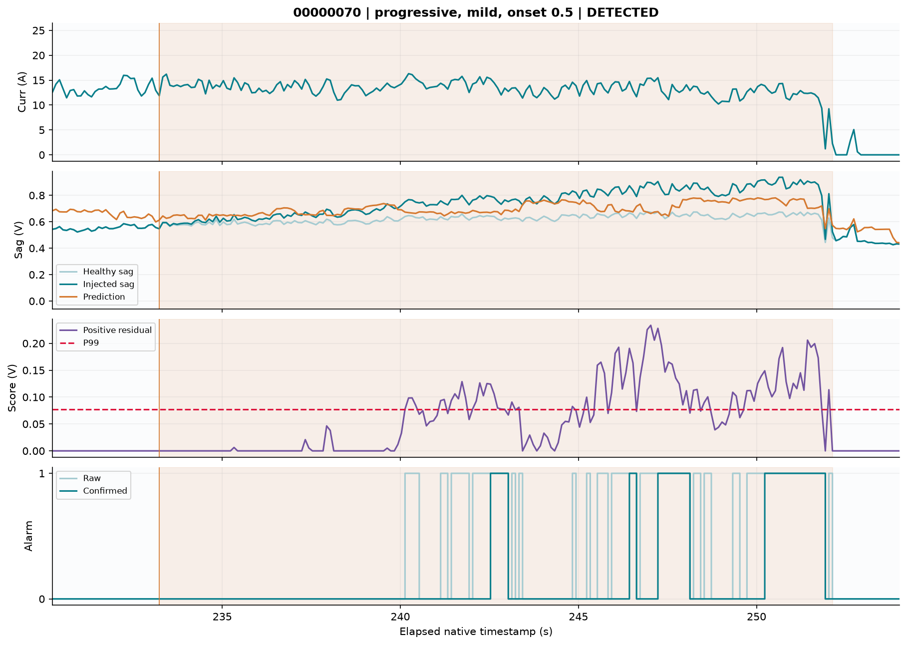

[Versi SVG](figures/timeline_00000070_progressive.svg).

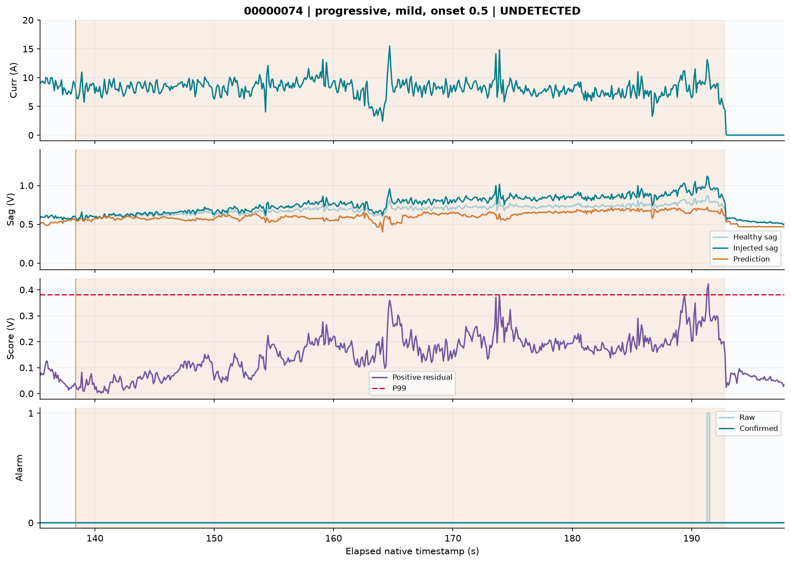

[Versi SVG](figures/timeline_00000074_progressive.svg).

Seluruh 18 contoh dan enam healthy timelines:

- [00000066 / increased_resistance / DETECTED](figures/timeline_00000066_increased_resistance.png)
- [00000066 / progressive / DETECTED](figures/timeline_00000066_progressive.png)
- [00000066 / sudden_drop / DETECTED](figures/timeline_00000066_sudden_drop.png)
- [00000069 / increased_resistance / DETECTED](figures/timeline_00000069_increased_resistance.png)
- [00000069 / progressive / DETECTED](figures/timeline_00000069_progressive.png)
- [00000069 / sudden_drop / DETECTED](figures/timeline_00000069_sudden_drop.png)
- [00000070 / increased_resistance / DETECTED](figures/timeline_00000070_increased_resistance.png)
- [00000070 / progressive / DETECTED](figures/timeline_00000070_progressive.png)
- [00000070 / sudden_drop / DETECTED](figures/timeline_00000070_sudden_drop.png)
- [00000071 / increased_resistance / DETECTED](figures/timeline_00000071_increased_resistance.png)
- [00000071 / progressive / DETECTED](figures/timeline_00000071_progressive.png)
- [00000071 / sudden_drop / DETECTED](figures/timeline_00000071_sudden_drop.png)
- [00000073 / increased_resistance / DETECTED](figures/timeline_00000073_increased_resistance.png)
- [00000073 / progressive / DETECTED](figures/timeline_00000073_progressive.png)
- [00000073 / sudden_drop / DETECTED](figures/timeline_00000073_sudden_drop.png)
- [00000074 / increased_resistance / UNDETECTED](figures/timeline_00000074_increased_resistance.png)
- [00000074 / progressive / UNDETECTED](figures/timeline_00000074_progressive.png)
- [00000074 / sudden_drop / DETECTED](figures/timeline_00000074_sudden_drop.png)

- [Healthy flight 00000066](figures/healthy_00000066.png)
- [Healthy flight 00000069](figures/healthy_00000069.png)
- [Healthy flight 00000070](figures/healthy_00000070.png)
- [Healthy flight 00000071](figures/healthy_00000071.png)
- [Healthy flight 00000073](figures/healthy_00000073.png)
- [Healthy flight 00000074](figures/healthy_00000074.png)

Seluruh 162 scenario scores tetap tersedia pada sumber frozen, bukan hanya contoh yang digambar. Tabel indeks di bawah menghubungkan setiap event ke CSV.gz per sampelnya; CSV berisi timestamp native, current, voltage, actual/predicted sag, residual, raw/confirmed, support dan phase. Full-log prefix diproses oleh eksperimen asli; reporter hanya membaca keputusan tersimpan.

[Buka indeks interaktif seluruh 162 skenario](scenario_index.html): cari berdasarkan flight, family, severity atau status, lalu buka score CSV.gz asli.

- [scenario_index](tables/scenario_index.csv)
- [event_metrics](tables/event_metrics.csv)
- [scenario_metrics](tables/scenario_metrics.csv)
- [grouped_results](tables/grouped_results.csv)
- [pooled_results](tables/pooled_results.csv)
- [macro_results](tables/macro_results.csv)
- [healthy_combined](tables/healthy_combined.csv)
- [fold_assignments](tables/fold_assignments.csv)
- [calibration](tables/calibration.csv)
- [false_alarm_episodes](tables/false_alarm_episodes.csv)
- [model_comparison](tables/model_comparison.csv)
- [ablation](tables/ablation.csv)
- [low_load](tables/low_load.csv)

## 11. Provenance, verifikasi, dan reproduksibilitas laporan

Sumber baseline diverifikasi terhadap seluruh 217 output hashes pada manifest; preprocessing dan feature outputs juga diperiksa. Reporter merekonsiliasi pooled regression dari sufficient statistics, seluruh confirmed confusion/event/delay dari 162 score files, serta membangun raw diagnostic dengan reset segment/gap. Seluruh source baseline files diperiksa lagi setelah pelaporan untuk memastikan tidak berubah. Tidak ada estimator pickle dimuat dan tidak ada fit/predict, bank regeneration, calibration atau model selection oleh reporter.

| Peran | Run / sumber |
| --- | --- |
| Baseline utama | 4bc978e2773687d3 |
| Preprocessing | e22890aeb6ffddf6 |
| Features | 1225e8a76a8ce014 |
| Bank seluruh 17 flight | 437104037cb0fea5 |
| Konsolidasi | 4ad7e153513e7d64 |
| Replay historis | ee132dc3901fb80a |
| Diagnosis Flight 66 | artifacts/flight66_diagnosis |

| Pustaka | Versi scoring sumber |
| --- | --- |
| numpy | 2.5.4 |
| pandas | 3.0.6 |
| scikit-learn | 1.9.1 |
| PyYAML | 6.0.3 |
| pytest | 9.1.1 |
| matplotlib | 3.11.2 |
| joblib | 1.6.0 |

```text
Raw CSV SHA256: bc83a9a1bde9dc2412c1ce80429a336bead23df4daf97c12f3cb8ed554019368
Feature manifest SHA256: c102814929b097f9fa3e2f993bedf2348471fcd625d524a8aee2fd7c6ca02f85
Baseline config SHA256: 6ba44bcae775eacad4beeae687cfa5a4f47cb0d9f63cdcecab6285438a435074
Baseline manifest SHA256: 03bcd9e3520d7fcd47930e27c92c253f39c683dfcbf2699447c0b4b79058e213
```

Audit software Sprint 13 tersimpan mencatat 371 tests, nol failure/error/skip; sebelas kelompok audit dan 103 model bundles diperiksa. Itu bukti historis, bukan pengujian ulang hari ini. Diagnosis Flight 66 memiliki audit PASS dan exact original policy replay. Reporter mencatat pemeriksaan integritas, angka, link dan gambar pada metadata laporan; kelulusan tersebut tidak mengubah hasil penelitian yang belum memenuhi target gradual.

Replay historis memverifikasi 761.095 rows pada 179 jobs terhadap batch, max numeric error=0 dalam hasil tersimpan. Latency healthy uncached host p50/p95/p99=1,634/2,184580/2,857084 ms; max=21,8337 ms. Pengukuran berjalan bersamaan dengan pytest, sehingga bukan benchmark hardware UAV. Sebanyak 725.490 cached synthetic predictions dipisahkan dari latency uncached. Laporan ini tidak mengukur ulang latency atau menjalankan streaming fisik. Dual tidak dipromosikan dan status replay tetap BASELINE_SOFTWARE_REPLAY_ONLY.

```powershell
.\.venv\Scripts\python.exe scripts/build_research_report.py --output artifacts/reports/research_v2_20261026_new
```

Perintah memerlukan direktori keluaran baru/kosong dan menulis laporan serta grafik dari artefak yang sudah tersedia. [Angka terstruktur](numbers.json), [aturan pemilihan grafik](figure_selection.json), [metadata dan hasil pemeriksaan](report_metadata.json), dan [manifest output](report_manifest.json) disertakan. SHA256 input serta template dicatat; template berfungsi sebagai referensi penyajian, bukan sumber angka V2.

## 12. Penilaian akhir dan prioritas penelitian berikutnya

Baseline berhasil mendeteksi mayoritas intervensi listrik yang ditetapkan, terutama abrupt severe, tetapi false alarm yang terkonsentrasi pada Flight 66 dan respons gradual yang lambat membatasi kegunaannya. Bukti diagnosis mendukung keterbatasan generalisasi model pada late-discharge/low-current setelah beban, dengan representasi CurrTot di luar training support dan fixed initial reference sebagai konteks utama. Tidak ada bukti cukup untuk menyimpulkan kerusakan internal baterai atau mengukur kontribusi kausal masing-masing faktor dari log ini saja.

| Prioritas | Langkah penelitian | Dasar bukti / kriteria berikutnya |
| --- | --- | --- |
| 1 | Tambah healthy development lintas pack/session, terutama akhir discharge dan low-current setelah load | 92,93% alarms di atas CurrTot train max; protokolkan flight/pack holdout yang belum diperiksa |
| 2 | Studi terpisah representasi keadaan dan target/reference secara kausal | Bias panjang pada current hampir nol; bandingkan dengan split dan denominator tetap |
| 3 | Verifikasi unit/reset/continuity CurrTot dan metadata kondisi | Upper-bin saturation teramati; jangan menyebut kanal sebagai SOC tanpa bukti |
| 4 | Evaluasi calibration transfer dan monitoring domain/uncertainty | Validation residual dan late-test residual berbeda; pertahankan FPR, episode dan deadline sebagai evaluasi bersama |
| 5 | Teliti recovery/load-response dan deteksi gradual | 224 alarms dalam CurrTot range dan progressive target 12/51; tetapkan eksperimen baru sebelum scoring |

Rekomendasi merupakan rancangan penelitian berikutnya dan belum diterapkan oleh laporan ini. Flight 66 tetap healthy-assumed dan tetap bagian hasil; tidak dihapus atau diubah labelnya karena detector alarm. Jika hasil Flight 66 dipakai untuk refinement, flight itu menjadi development evidence dan tidak boleh diklaim independent holdout sesudahnya. Kesimpulan mencakup software, generalisasi pada telemetry historis dan intervensi sintetis; belum mencakup validasi switching fisik atau deployment keselamatan.

Sumber utama dapat dibaca langsung: [baseline report](../../cross_validation/4bc978e2773687d3/research_report.md), [diagnosis Flight 66](../../flight66_diagnosis/ROOT_CAUSE_ANALYSIS.md), [hasil final Sprint 13](../../../FINAL_RESEARCH_RESULTS.md), [verifikasi Sprint 13](../../sprint13/verification.json).
